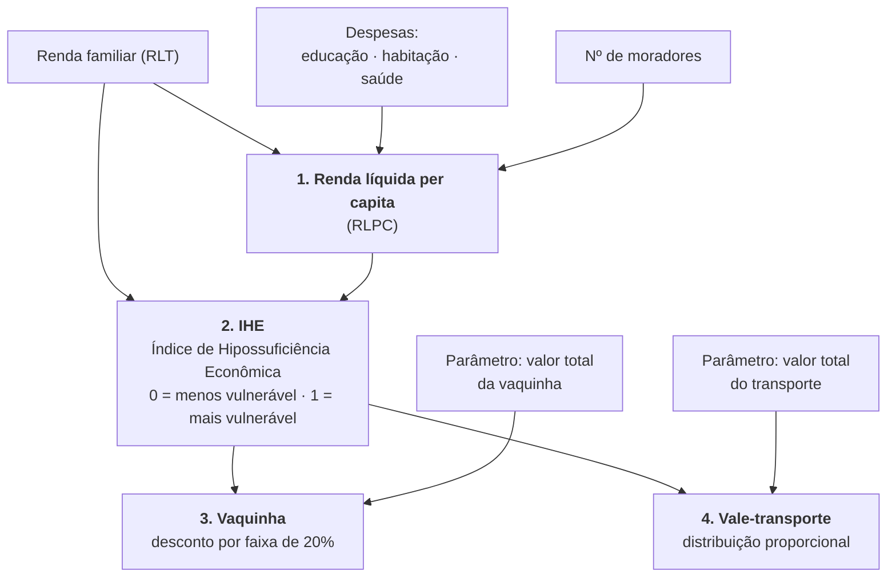

# Benefícios e cálculos

Como a ONG decide **quanto cada família ajuda a pagar (vaquinha)** e **quanto cada aluno recebe de
vale-transporte**. Tudo parte de **um único índice**, o **IHE**, calculado a partir da renda e dos gastos da
família.

> **Situação:** as fórmulas e regras estão **definidas pela ONG** (documentos de cálculo). **Nada disso está
> implementado ainda** no sistema.

## Visão geral



## 1. Renda líquida per capita (RLPC)

Quanto sobra por morador depois de descontar os gastos essenciais da família.

```
RLPC = ( Renda familiar − Despesa com educação − Despesa com habitação − Despesa com saúde ) ÷ Nº de moradores
```

- Despesa **não informada conta como zero** (não zera o cálculo).
- É a mesma fórmula do Access atual.
- **Exemplo:** renda R$ 6.000, despesas de R$ 400 (educação), R$ 300 (habitação) e R$ 300 (saúde), 4 moradores
  → (6.000 − 1.000) ÷ 4 = **R$ 1.250**.

## 2. IHE — Índice de Hipossuficiência Econômica

É o **nome oficial** do que a conversa chamava de "índice de carência". Mede **a posição de uma família em
relação às demais**: quanto menor a renda e a renda per capita, maior o IHE.

### Passo 1 — Normalização (Min–Max)

Cada valor é transformado numa nota de **0 a 1**, comparando com o menor e o maior da base:

```
RLT_normalizada  = (RLT  − menor RLT)  ÷ (maior RLT  − menor RLT)
RLPC_normalizada = (RLPC − menor RLPC) ÷ (maior RLPC − menor RLPC)
```

onde **RLT** é a renda familiar total e **RLPC** a renda líquida per capita. "Menor" e "maior" são os extremos
**de toda a base** avaliada.

### Passo 2 — Cálculo final

```
IHE = 1 − ( 0,5 × RLT_normalizada + 0,5 × RLPC_normalizada )
```

Os dois critérios têm **peso igual (50% / 50%)**.

### Como ler o resultado

| IHE            | Significado                                    |
|----------------|------------------------------------------------|
| **1**          | Máxima vulnerabilidade econômica da base       |
| **0**          | Mínima vulnerabilidade econômica da base       |
| entre 0 e 1    | Posição relativa dentro da população avaliada  |

### Exemplo completo

Três famílias, uma pessoa avaliada por família:

| Família | Renda | Despesas | Moradores | RLPC        |
|---------|-------|----------|-----------|-------------|
| A       | 1.500 | 0        | 3         | R$ 500      |
| B       | 3.000 | 0        | 2         | R$ 1.500    |
| C       | 6.000 | 1.000    | 4         | R$ 1.250    |

Menor/maior renda: 1.500 / 6.000 · menor/maior RLPC: 500 / 1.500.

| Família | RLT norm. | RLPC norm. | **IHE** = 1 − (0,5·RLT + 0,5·RLPC) |
|---------|-----------|------------|------------------------------------|
| A       | 0,000     | 0,000      | **1,000** (mais vulnerável)        |
| B       | 0,333     | 1,000      | **0,333**                          |
| C       | 1,000     | 0,750      | **0,125** (menos vulnerável)       |

> ⚠️ **O IHE de uma família muda quando entra ou sai outra**, porque depende dos extremos da base. Por isso é
> preciso definir **qual é a base** (decisão a tomar com a ONG).

## 3. Vaquinha

Contribuição da família para ajudar a comprar os materiais. **Quanto mais vulnerável, maior o desconto.**

### Valor e desconto

O valor total da vaquinha é um **parâmetro geral**. O desconto de cada pessoa vem da **faixa de 20%** em que ela
está no ranking de carência (do mais ao menos vulnerável, pelo IHE):

| Posição no ranking (do mais carente ao menos carente) | Desconto |
|-------------------------------------------------------|----------|
| Primeiros **20%** mais carentes                       | **100%** (não paga) |
| **20% – 40%**                                         | **80%**  |
| **40% – 60%**                                         | **60%**  |
| **60% – 80%**                                         | **20%**  |
| **80% – 100%** (menos carentes)                       | **0%** (paga integral) |

```
Valor da vaquinha da pessoa = Valor total da vaquinha × (1 − desconto da faixa)
```

### Regras

- O **valor total** da vaquinha é informado numa **tela de parâmetros** (ver [abaixo](#parâmetros-gerais)).
- **Mudar o valor** só vale para **novas matrículas** e para **pessoas cujo boleto ainda não foi gerado**. Quem
  já teve o boleto gerado **mantém o valor antigo**.
- Cada pessoa tem uma marcação **"boleto da vaquinha já gerado: sim/não"**, que controla a regra acima.
- Quem **contribui** recebe **todos** os materiais que o projeto consegue (inclusive os que precisam ser
  comprados). Quem **não contribui** recebe só os que o projeto **já tem** em estoque.

### Exemplo

Vaquinha de **R$ 300**, ranking de 10 pessoas (2 por faixa):

| Faixa (mais → menos carente) | Desconto | Paga       |
|------------------------------|----------|------------|
| 1º e 2º                      | 100%     | R$ 0,00    |
| 3º e 4º                      | 80%      | R$ 60,00   |
| 5º e 6º                      | 60%      | R$ 120,00  |
| 7º e 8º                      | 20%      | R$ 240,00  |
| 9º e 10º                     | 0%       | R$ 300,00  |

## 4. Vale-transporte

O valor total recebido para transporte é **distribuído entre as pessoas em proporção ao IHE**:

```
Valor da pessoa = Total a distribuir × ( IHE da pessoa ÷ soma dos IHE de todas as pessoas )
```

Por que essa fórmula é justa:

- Quem tem o **dobro do IHE recebe o dobro**.
- **IHE 0 → recebe 0**.
- Se **todos tiverem o mesmo IHE, todos recebem igual**.
- A **soma é sempre exatamente o total** a distribuir.

### Exemplo (da ONG)

Total de **R$ 1.000** e três alunos:

| Aluno | IHE  | Cálculo           | Recebe        |
|-------|------|-------------------|---------------|
| A     | 0,90 | 1.000 × 0,90 ÷ 1,6 | **R$ 562,50** |
| B     | 0,50 | 1.000 × 0,50 ÷ 1,6 | **R$ 312,50** |
| C     | 0,20 | 1.000 × 0,20 ÷ 1,6 | **R$ 125,00** |

Soma dos IHE = 0,90 + 0,50 + 0,20 = **1,60**.

### Regras

- O **total a distribuir** é um **parâmetro geral**: o valor que a ONG recebeu para transporte.
- O vale continua exigindo **assinatura** do aluno na retirada, com **lista por turma**
  ([processo anual](processo-anual.md#4-distribuição)).

## Parâmetros gerais

O sistema precisa de uma **tela de parâmetros** (acesso da Administração) com, no mínimo:

| Parâmetro                           | Usado em                            |
|-------------------------------------|-------------------------------------|
| **Valor total da vaquinha**         | Vaquinha de cada pessoa             |
| **Valor total para transporte**     | Distribuição do vale-transporte     |

A definir com a ONG: se outros itens também devem virar parâmetro (pesos 50/50 do IHE, percentuais de desconto,
número de faixas).

## Pontos de atenção (decisões que afetam o resultado)

| Ponto | Por que importa |
|-------|-----------------|
| **Base do Min–Max** | O IHE só existe em relação a um conjunto. Se a base for "todas as famílias já cadastradas", o IHE de todo mundo muda a cada cadastro novo. |
| **Centavos** | Dividir proporcionalmente gera frações de centavo. No exemplo de 3 famílias, os valores arredondados somam **R$ 999,99**, não R$ 1.000,00. É preciso decidir quem recebe o centavo restante. |
| **Casos limites** | Se todas as famílias tiverem a mesma renda, a normalização divide por zero. Se a soma dos IHE for zero, a distribuição não existe. |
| **Aluno × família** | O IHE é da **família**; irmãos têm o mesmo IHE. A vaquinha e o vale são **por pessoa**. |
| **Quem entra na distribuição** | A fórmula reparte entre "as pessoas do grupo". Falta definir se é **todo aluno** ou só os marcados com "ajuda com transporte". |

## Como o Access mostra hoje

A tela atual do Access exibe **faixas coloridas** (baixíssima, alerta de baixa, padrão, alerta de alta, muito
alta), as marcações **"Vaquinha"** e **"Ajuda com transporte"** e os campos de **desconto (%)** e **valor da
vaquinha**. A regra nova usa **faixas de 20%** (cinco, de 100% a 0% de desconto). Falta confirmar se as faixas
coloridas do Access continuam existindo ou se são substituídas pelas de 20%.
