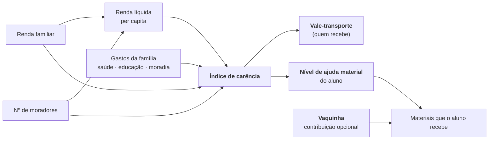

# Benefícios e cálculos

Como a ONG decide **quanta ajuda material cada aluno recebe**. Hoje o cálculo é feito no **Access**; o sistema
novo precisa reproduzi-lo. **As fórmulas exatas ainda não foram documentadas** — este documento registra o que
se sabe e lista o que precisa ser levantado com a ONG.

## Visão geral

## 1. Índice de carência

> Na reunião, a equipe comentou que **eles chamam por outro nome**. O nome oficial precisa ser confirmado.

- **O que é:** um número calculado a partir de **renda**, **número de integrantes da família** e **gastos** da
  família (**saúde, educação e residência**).
- **Para que serve:** define o **nível de ajuda material** que cada aluno vai receber e alimenta a
  **distribuição de benefícios**.
- **Hoje:** calculado no Access, por família.
- **Evolução desejada:** acompanhar a **evolução do índice ao longo dos anos** (indicador de impacto).

### Faixas visíveis na tela atual

A tela do Access exibe, ao lado do cálculo, **faixas de classificação** com cores. Pelo print, são cinco:

| Faixa (rótulo na tela)       | Cor      |
|------------------------------|----------|
| Baixíssima                   | vermelho |
| Alerta de baixa              | laranja  |
| Padrão                       | amarelo  |
| Alerta de alta               | amarelo  |
| Muito alta                   | roxo     |

> ❓ O print está parcialmente legível. É preciso confirmar com a ONG **os nomes exatos, os limites de cada
> faixa e o que cada uma significa** na prática.

## 2. Vale-transporte

- Destinado a alunos de **baixa renda**; o projeto **custeia**.
- O cálculo é feito **a partir do índice de carência**.
- Na tela atual há a marcação **"Ajuda com transporte"** por aluno/família.
- **Controle:** o aluno **assina** ao retirar; a secretaria mantém uma **lista por turma** de quem retira.
- **Indicadores desejados:** total distribuído e valor investido por mês.

## 3. Vaquinha

- É uma **contribuição opcional** da família para ajudar a comprar os materiais.
- **Se o aluno contribui:** recebe **todos** os materiais que o Projeto Resgate consegue — **inclusive os que
  precisam ser comprados**.
- **Se não contribui:** recebe **apenas os materiais que o projeto já possui** (estoque), e **não** os que
  dependem de compra.
- Na tela atual há a marcação **"Vaquinha"** e campos de **desconto (%)** e **valor da vaquinha** (ex.: desconto
  de 33% e valor de R$ 271,20 no exemplo fotografado).
- **Indicadores desejados:** controle financeiro da vaquinha.

## O que falta definir

| Pergunta                                                                                              | Quem responde            |
|-------------------------------------------------------------------------------------------------------|--------------------------|
| Qual a **fórmula** do índice de carência (pesos de renda, moradores, cada tipo de gasto)?              | Secretaria / Diretoria   |
| Quais os **limites das faixas** (baixíssima … muito alta) e o que cada faixa implica?                  | Diretoria                |
| Qual o **critério** para receber vale-transporte (qual faixa)? E qual o **valor**?                     | Diretoria                |
| Como o **valor da vaquinha** e o **desconto (%)** são calculados?                                      | Secretaria               |
| O **nome oficial** do índice de carência                                                               | Equipe                   |
| O índice é recalculado quando a renda/gastos mudam (recadastro anual)? Guardamos o histórico?          | Diretoria                |
| Renda per capita é **líquida**: o que entra no cálculo (salário, pensão, autônomos)?                   | Secretaria               |

> **Sugestão para levantar as fórmulas:** pedir à ONG uma exportação do Access com alguns alunos de exemplo (de
> cada faixa) e conferir o resultado do sistema novo contra eles antes de usar de verdade.
