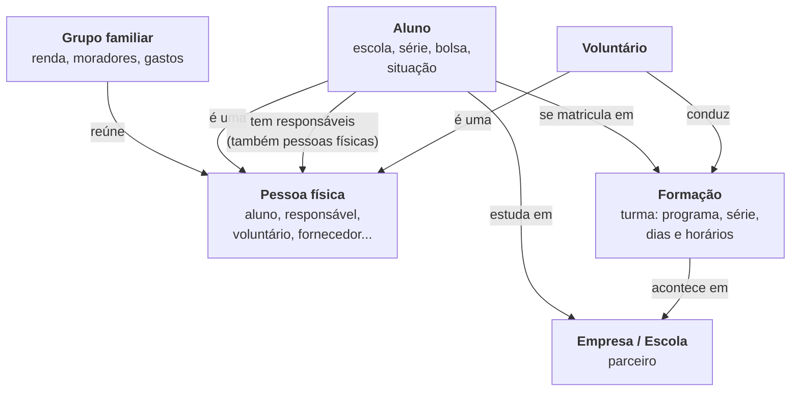
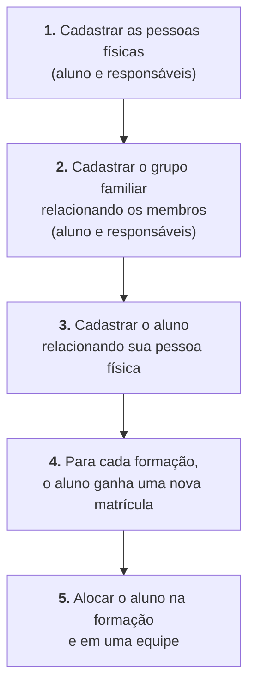

# Cadastros

O que a ONG cadastra, quais dados guarda e como os cadastros se relacionam.

## Como os cadastros se relacionam

**Ideia central:** a **pessoa física** é o cadastro único. Aluno, responsável e voluntário **não repetem** nome,
CPF ou telefone — apenas apontam para a pessoa. Uma mesma pessoa pode ter mais de um papel (ex.: um responsável
que também faz uma formação como aluno).

## Pessoa física

Tela única de **cadastro e listagem** de pessoas físicas: responsáveis, alunos, fornecedores etc.

| Dado                              | Observação                                                       |
|-----------------------------------|------------------------------------------------------------------|
| Nome, apelido                     |                                                                  |
| Gênero                            | Masculino, feminino ou outro                                     |
| Data de nascimento                | Não pode ser no futuro                                           |
| CPF e RG                          | CPF **não se repete** entre pessoas                              |
| Telefone, celular, e-mail         | Pedidos para **todos** (não só para o responsável)               |
| Local de trabalho                 | Aparece na tela atual do Access (campo "Trabalho")               |

- Na tela da pessoa devem aparecer **as informações do grupo familiar dela** (ex.: no cadastro da mãe, o grupo
  familiar da mãe).
- O **cadastro dos responsáveis pode ser feito dentro do cadastro do aluno**, sem precisar sair da tela.

## Grupo familiar

É a "família" do aluno. Serve para calcular a ajuda material e para saber **quem mora junto**.

| Dado                                    | Observação                                                         |
|-----------------------------------------|--------------------------------------------------------------------|
| Identificador da família                | Número amigável (hoje no Access: "Grupo Familiar ID", ex.: 401)    |
| **Quem mora aqui**                      | Lista de membros — pessoas físicas já cadastradas                  |
| Quantidade de moradores                 |                                                                    |
| **Renda familiar**                      |                                                                    |
| **Renda líquida per capita**            | (Renda − despesas de educação, habitação e saúde) ÷ moradores. Ex.: R$ 3.000, sem despesas, 2 moradores → R$ 1.500 ([fórmula](beneficios-e-calculos.md#1-renda-líquida-per-capita-rlpc)) |
| **Despesas** com educação, saúde e moradia/habitação |                                                       |
| Endereço                                | **Ver aviso abaixo**                                               |

**Como colocar uma pessoa numa família que já existe:** pesquisa-se a pessoa por **CPF, RG, nome ou apelido**,
seleciona-se o resultado e adiciona-se à família. Se a pessoa ainda não estiver cadastrada, ela pode ser criada
na hora, já dentro da família.

> ❓ **Endereço — divergência a resolver.** A definição é que o grupo familiar **não terá endereço** e que o
> endereço do aluno será **puxado do cadastro da pessoa física**. O sistema hoje faz o contrário: o endereço fica
> na família e a pessoa física não tem endereço.

Tela de listagem: haverá uma **listagem de grupos familiares**.

## Aluno

Pré-requisito: o aluno **precisa estar cadastrado como pessoa física** e **pertencer a um grupo familiar**.

| Dado                                       | Observação                                                          |
|--------------------------------------------|---------------------------------------------------------------------|
| Pessoa física (dados pessoais)             | Vem do cadastro da pessoa                                           |
| **Escola** (colégio) e **série**           | Escola é uma empresa/instituição cadastrada                         |
| **Matrícula na escola**                    |                                                                     |
| **Ano letivo**                             |                                                                     |
| **Condição de bolsa**                      | Diferenciar **bolsista de APE** ❓ (a confirmar com a ONG)                    |
| Interesse em artes                         | Marcação simples                                                    |
| **Nome da mãe e do pai**                   | Pedidos **independente** de serem responsáveis ou não               |
| **Responsáveis**                           | Ver abaixo                                                          |
| **Situação:** ativo ou não                 | Se não: **motivo do desligamento**                                  |
| **Documentos** e termos assinados          | Upload de arquivos (ver abaixo)                                     |
| **Turno**                                  | Consta no Access atual                                              |

### Responsáveis do aluno

Cada responsável é uma **pessoa física do mesmo grupo familiar** e tem:

- **Grau de parentesco** (mãe, pai, madrasta, padrasto, avó, avô, tia, tio, irmã, irmão, responsável legal, outro);
- **Função:** **responsável pela comunicação** e/ou **responsável financeiro**;
- **Escolaridade**, **renda** (e a origem: salário, pensão, autônomo) — anotações da equipe pedagógica;
- Dados completos: RG, CPF, telefone, endereço etc.

O Access atual comporta até **4 responsáveis** por aluno. Um aluno **não pode ser responsável de si mesmo**.

### Documentos e termos

- A ONG precisa **guardar arquivos no cadastro**: documentos do aluno e **termos de compromisso assinados**
  (incluindo **autorização de uso de imagem**).
- A ideia da equipe: ao cadastrar o grupo, **criar uma pasta do grupo**, digitalizar os documentos e guardá-los
  numa **categoria "documentos"**; o **termo de compromisso** e a **autorização de imagem** ficam à parte.
- Os arquivos ficam no [**drive interno**](#drive-interno) do Projeto Resgate (não no Google Drive).

### Drive interno

Funcionalidade combinada com a ONG: um **drive interno do Projeto Resgate**, dentro do próprio sistema, para
**armazenar documentações e outros arquivos** num lugar só, em vez de espalhados em pastas e e-mails.

| O que se sabe                                                                                              |
|------------------------------------------------------------------------------------------------------------|
| Guarda **documentos e termos** do aluno (documentos pessoais, **termo de compromisso**, **autorização de imagem**) |
| Guarda a **documentação do projeto**, "dentre outras coisas" (escopo completo ainda a detalhar)            |
| A equipe pedagógica descreveu a organização desejada: uma **pasta por grupo (família)**, com os documentos digitalizados numa **categoria "documentos"** e o **termo de compromisso** e a **autorização de imagem** à parte |
| Substitui a integração com o Google Drive que constava na Proposta de Melhoria                              |

**A detalhar com a ONG antes de construir:** quais outros tipos de conteúdo entram; como as pastas se organizam
(por família, por aluno, por formação, do projeto); **quem pode ver e enviar** cada tipo de arquivo (depende dos
[perfis de acesso](o-projeto.md#níveis-de-acesso-propostos-para-o-sistema)); formatos e tamanho máximo; por quanto
tempo guardar (são dados de crianças: LGPD).

### Histórico do aluno

A equipe pediu um **histórico do caminho formativo** de cada aluno: em quais formações esteve, presenças,
benefícios recebidos e desistências/retornos.

## Processo de cadastro de um aluno

- Sugestão: fazer o cadastro de aluno **em etapas (steps)**, para não ser um formulário gigante.
- **Pais e responsáveis também podem virar alunos**, pois há formações direcionadas a eles.
- Uma formação pode ter **várias equipes**; o aluno entra em uma delas. ❓ (a confirmar com a ONG)

## Formação (turma)

É a oferta de uma atividade: por exemplo, **"Formação de Valores — 7º ano"**, às quintas, das 19h às 20h30.

| Dado                              | Observação                                                          |
|-----------------------------------|---------------------------------------------------------------------|
| **Programa** (tipo de formação)   | Ex.: formação de valores                                            |
| **Instituição** (onde acontece)   | Empresa/escola parceira                                             |
| **Séries atendidas**              | Uma ou várias (a "fase escolar sugerida")                           |
| **Dias da semana e horários**     | Pode ter mais de um dia                                             |
| **Período**                       | Data de início e duração em meses                                   |
| Previsão de alunos                | Estimativa — não é limite                                           |
| Observações                       | Texto livre                                                         |
| **Ativa**                         | Se a turma está em andamento                                        |
| **Voluntários da turma**          | Cada um com sua **função** (as funções vêm do programa)             |
| **Alunos da turma**               | Matriculados                                                        |
| **Frequência**                    | Presença das aulas (ver [indicadores](indicadores-e-relatorios.md)) |

O **nome da turma é montado automaticamente**: `Programa - séries - dias`, por exemplo
**"Formação de Valores - 7º ano - Qui"**.

## Voluntários e funcionários

| Dado                                      | Observação                                                         |
|-------------------------------------------|--------------------------------------------------------------------|
| Pessoa física                             | Dados pessoais                                                     |
| É voluntário?                             | Sim/não                                                            |
| Empresa vinculada                         | Opcional (voluntário que vem de uma empresa)                       |
| **Disponibilidade** de horários           | ⬜ Pedido: base para alocar alunos e formações                      |
| **Capacitação**                           | ⬜ Pedido: gestão do perfil e atribuições                           |
| Função em cada formação                   | Ex.: professor, auxiliar (definido no programa)                    |

## Empresas e escolas

Cadastro de pessoa jurídica para **escolas, empresas parceiras, editoras e fornecedores**: CNPJ, razão social,
nome de exibição, situação cadastral, **endereço** e **representante** (nome e contatos).

## Programas e séries

- **Programa:** nome, situação (ativo/inativo), site e as **funções de voluntário** que ele admite.
- **Séries escolares:** catálogo com nome, abreviação (ex.: "7º ano") e **ordem** (usada para organizar o
  nome das turmas).

## Materiais ⬜

Ainda **não existe** no sistema. A ONG pediu:

| Campo do cadastro de material | Observação                                              |
|-------------------------------|---------------------------------------------------------|
| **Título**                    |                                                         |
| **Tipo do material**          | Livro, apostila etc.                                    |
| **Valor**                     |                                                         |
| **Quantidade**                | Em estoque                                              |

E o controle de **entregas por aluno**, **status da solicitação**, **orçamentos** e **parcerias com editoras**.
