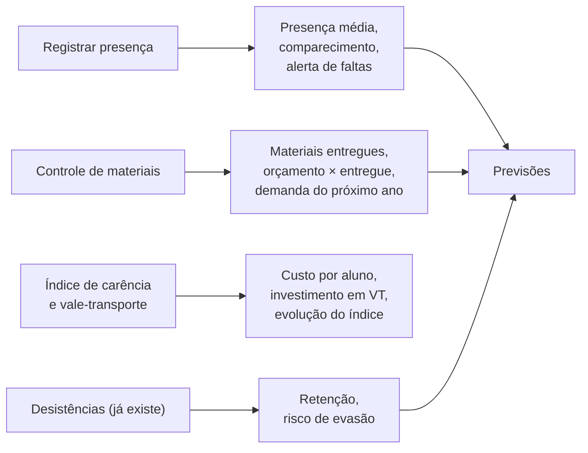

# Indicadores e relatórios

O que a ONG quer **extrair** do sistema. Vem da Proposta de Melhoria e das anotações da equipe pedagógica
("Saídas"). Nada disto existe ainda — é a lista de desejos que orienta as próximas etapas.

## Para quem são

| Público                       | Para quê                                                                   |
|-------------------------------|----------------------------------------------------------------------------|
| **Gestão** (presidência)      | Decidir, acompanhar custos e a saúde financeira                            |
| **Pedagógico**                | Acompanhar participação, evasão e o caminho de cada aluno                  |
| **Empresas e universidades parceiras** | Mostrar o **retorno** do apoio recebido                           |
| **Prestação de contas**       | Relatórios de impacto e financeiros                                        |

## Indicadores operacionais

| Indicador                                                  | Detalhe                              |
|------------------------------------------------------------|--------------------------------------|
| Total de **alunos ativos**                                 | Por série, por escola, por turma, por turno, por bairro/região |
| **Presença média** por turma/formação                      | A partir das listas de presença      |
| **Taxa de comparecimento** às formações                    |                                      |
| **Materiais entregues** por período                        | Livros, apostilas e vale-transporte  |
| **Vales-transporte distribuídos**                          |                                      |
| **Voluntários ativos** por mês                             | E número de mentores                 |

## Indicadores financeiros

| Indicador                                                  |
|------------------------------------------------------------|
| **Custo médio por aluno** atendido                         |
| **Orçamento × materiais entregues**                        |
| **Valor investido em vale-transporte** por mês             |
| Custo por **tipo de recurso** (material, transporte, equipe)|
| Controle financeiro da **vaquinha**                        |

## Indicadores de impacto

| Indicador                                                              |
|------------------------------------------------------------------------|
| **Evolução do índice de carência** das famílias ao longo dos anos      |
| **Engajamento** dos alunos (presença, participação, feedbacks)         |
| **Retenção** de alunos entre ciclos (ano a ano)                        |
| **Satisfação** dos pais/responsáveis (via formulários integrados)      |

## Listas e documentos que o sistema deve produzir

Das anotações da equipe pedagógica:

- **Listas de chamada**, com **percentual de participação** por aluno;
- **Número de alunos** por série, colégio e turno;
- **Número de alunos por atividades** oferecidas;
- **Quantidade** de livros, apostilas e vales-transporte distribuídos;
- **Número de voluntários** e de **mentores**;
- **Listas por bairro/região**;
- **Listas de benefícios por aluno**;
- **Informações e fontes** com frequência e relatórios.

Exportação em **PDF e Excel** foi pedida na Proposta de Melhoria.

## Previsões (fase posterior)

Com algoritmos simples (regressão linear, séries temporais) sobre o histórico, a proposta prevê:

| Previsão                                                                 |
|--------------------------------------------------------------------------|
| **Demanda de materiais** escolares por série/aluno para o próximo ano    |
| **Risco de evasão ou ausência**, com base no histórico de faltas         |
| **Voluntários necessários**, a partir do número de turmas e da disponibilidade histórica |

> Essas previsões só funcionam depois de **um ano ou mais de dados** reais de presença, materiais e
> desistências. A prioridade é **coletar os dados** corretamente desde já.

## Dependências

A tabela mostra por que **presença**, **materiais** e **índice de carência** vêm antes dos painéis: sem esses
dados, os indicadores não têm de onde sair. Só o indicador de **retenção/desistência** já tem dados hoje.
