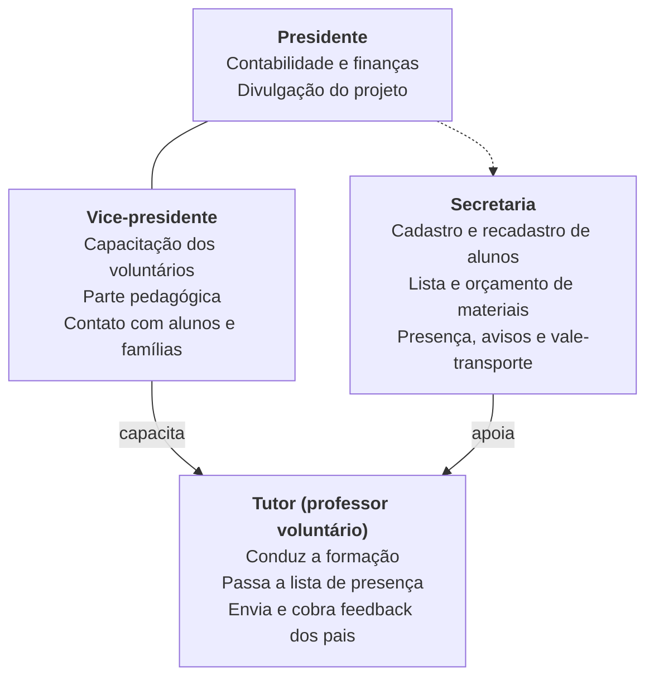

# O Projeto Resgate

O **Projeto Resgate** é uma iniciativa social que apoia crianças e adolescentes em idade escolar com
**formações** (atividades educativas conduzidas por voluntários), **materiais escolares** e, para famílias de
baixa renda, **vale-transporte**. O acompanhamento de cada aluno é feito ao longo dos anos.

## Para que serve o sistema

Hoje a informação da ONG está espalhada em várias ferramentas e planilhas (ver
[como é hoje](#como-é-hoje)). O objetivo do sistema é **unificar tudo num lugar só**, para:

- cadastrar alunos, famílias, voluntários e parceiros **uma vez só**;
- saber em que formação cada aluno está e quem são os voluntários;
- controlar presença, materiais e vale-transporte;
- calcular a ajuda de cada família de forma padronizada;
- gerar indicadores para a gestão, para parceiros e para prestação de contas.

> Escopo definido no Documento de Mapeamento (julho/2025): *"sistema único (web) com front-end, API e
> banco de dados centralizado, para unificar e automatizar os principais processos"*.

## Quem faz o quê

| Papel                         | Responsabilidades (como a ONG descreveu)                                                                                       |
|-------------------------------|---------------------------------------------------------------------------------------------------------------------------------|
| **Presidente**                | Gestão da contabilidade e financeira; divulgador do projeto.                                                                    |
| **Vice-presidente**           | Capacitação dos voluntários; responsável pela parte pedagógica; contato com alunos e familiares quando necessário.              |
| **Tutor (professor voluntário)** | Passa por entrevista/conversa e capacitação; recebe o conteúdo a abordar mas tem **liberdade metodológica**; passa a lista de presença em cada aula; envia formulários de feedback aos pais ao fim de cada semestre e cobra o preenchimento. |
| **Secretária**                | Cadastra e recadastra alunos; elabora a lista de materiais; faz orçamentos; transfere listas de presença para planilha e arquiva; repassa avisos às famílias; controla o vale-transporte. |

### Níveis de acesso propostos para o sistema

A Proposta de Melhoria define **três níveis**:

| Nível                       | Pode…                                                                                             | Situação |
|-----------------------------|---------------------------------------------------------------------------------------------------|----------|
| **Administração**           | Tudo: dados, relatórios, usuários, permissões e indicadores                                       | 🟡 Existe só este nível, sem restrições por perfil |
| **Secretaria**              | Cadastros, listas de presença, distribuição de materiais, comunicação com alunos e responsáveis   | ⬜        |
| **Professores/Voluntários** | Acessar as próprias turmas, lista de presença, envio de feedbacks                                 | ⬜        |

## Como é hoje

| O que                         | Onde fica hoje                                         | Problema apontado                                    |
|-------------------------------|--------------------------------------------------------|------------------------------------------------------|
| Cadastro de alunos            | Parte no **Access**, parte no **EVN (Escola Via Net)** | Informação em **duas fontes** diferentes             |
| Cadastro de turmas/formações  | EVN                                                    | —                                                    |
| Índice de ajuda a cada aluno  | **Access** (calculado com renda, moradores e gastos)   | Preso a um arquivo local                             |
| Controle de materiais entregues | Access                                               | —                                                    |
| Lista de materiais a comprar  | Planilha Excel                                         | Montada à mão a partir das séries dos alunos         |
| Lista de presença             | **Papel assinado** → depois digitada no Excel          | Retrabalho; sem alerta de faltas                     |
| Vale-transporte               | Lista física por turma, assinada na retirada           | Controle em papel                                    |
| Feedback dos responsáveis     | Google Forms → exportado para Excel                    | Dados fora do cadastro do aluno                      |
| Lista de voluntários          | Formulário online (exportação mensal)                  | —                                                    |
| Doações                       | Plataforma **DoeFácil** (integração via API)           | —                                                    |
| Relatórios de impacto         | PDFs internos de acesso restrito                       | Não estruturados                                     |

A ONG usa **apenas sistemas em nuvem** (não tem hardware próprio) e possui licenças de Google Workspace e
Microsoft 365.
