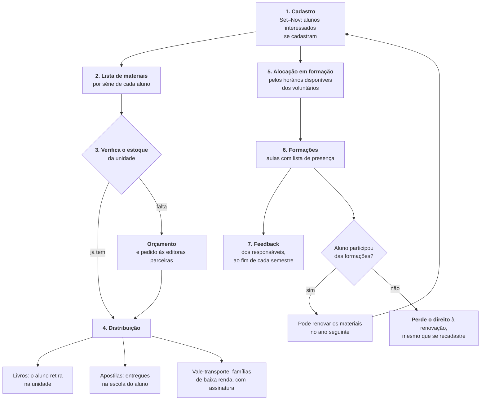

# O ano no Projeto Resgate

Descreve o ciclo anual como a ONG o executa **hoje**, conforme o Documento de Mapeamento (julho/2025). É a
base para saber o que o sistema precisa apoiar.

## Visão do ciclo

## Etapa por etapa

### 1. Cadastro (setembro a novembro)

- Os alunos interessados se cadastram **entre setembro e novembro**.
- Cadastro **fora do período é permitido**, mas o aluno **não tem garantia de receber os materiais** auxiliares.
- Quem faz: a **secretaria**, que também faz o **recadastro** nos anos seguintes.
- Cada família tem seu cadastro com renda, moradores e gastos — é daí que sai a ajuda material
  (ver [Benefícios e cálculos](beneficios-e-calculos.md)).

### 2. Lista de materiais

Terminado o período de cadastro, a secretaria monta a **lista de materiais escolares** conforme o **período
escolar (série)** de cada aluno cadastrado.

### 3. Estoque e compras

Com a lista pronta, confere-se o **estoque da unidade**. O que falta é **orçado** e **solicitado às editoras
parceiras**.

### 4. Distribuição

| Item               | Como chega ao aluno                                              |
|--------------------|------------------------------------------------------------------|
| **Livros**         | O próprio aluno **retira na unidade** do projeto                 |
| **Apostilas**      | **Entregues na escola** onde o aluno estuda                      |
| **Vale-transporte**| Só para **baixa renda**; o projeto custeia. Na retirada, o aluno **assina** um documento atestando o recebimento. A secretaria faz uma **lista por turma** de quem precisa retirar. |

### 5. Alocação nas formações

- Cada formação tem uma **fase escolar sugerida**, mas a alocação final **depende da disponibilidade dos
  voluntários**.
- O aluno **informa os períodos em que está disponível**; a equipe o aloca numa formação compatível.
- O aluno é avisado de qual formação vai frequentar **perto do início das atividades**.
- Um aluno pode se inscrever em **mais de uma formação**; **para cada formação ele ganha uma nova matrícula**.
- Pais e responsáveis também podem ser alunos, porque existem formações voltadas a eles.

### 6. Formações e presença

- Em cada aula, o **tutor** passa uma **lista de presença** para os alunos assinarem.
- A lista é entregue à secretaria, que **digita as presenças numa planilha** e **arquiva o papel**.
- A lista traz: atividade, dia/horário, voluntários, mês, nome do aluno, **colégio** e **série**, e um campo
  de **comentário/justificativa** por data.

### 7. Feedback

Ao fim de cada semestre, o tutor envia **formulários de feedback aos pais** e cobra o preenchimento. Hoje isso
é feito pelo Google Forms.

### 8. Renovação no ano seguinte

> **Regra:** o aluno que **não participa** das formações propostas **não tem direito à renovação dos
> materiais** no ano seguinte, **mesmo que faça o recadastro**.

## Cadastro fora do período e renovação: o que o sistema precisa saber

Para aplicar essas duas regras, o sistema precisará:

1. conhecer o **período de cadastro** de cada ano (set–nov);
2. saber a **participação** do aluno nas formações (a partir da presença);
3. alertar a secretaria sobre **cadastros fora do prazo** e sobre **alunos sem direito à renovação**.

Hoje nenhum desses três pontos está no sistema — ver [Situação do sistema](situacao-do-sistema.md).
