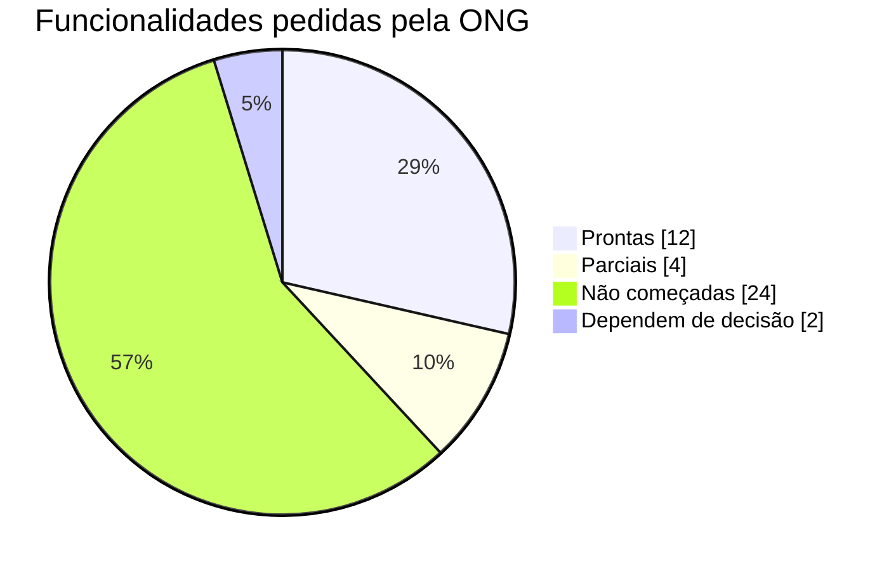
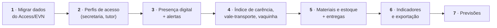

# Situação do sistema

Comparação entre **o que a ONG pediu** (reuniões, Mapeamento, Proposta de Melhoria) e **o que o sistema já faz**.
Atualizado em **14/11/2026**. Use este documento para priorizar.

Legenda: ✅ pronto · 🟡 parcial · ⬜ não começou · ❓ depende de decisão
(ver [legenda](README.md#legenda-de-status)).

## Resumo

> Contagem das 42 linhas das tabelas abaixo. **O núcleo de cadastros está pronto** (pessoas, famílias, alunos,
> formações, voluntários); **o que falta é o que gera valor operacional**: presença, materiais, cálculos de
> benefício, perfis de acesso e indicadores.

## Cadastros

| Funcionalidade                                                        | Status | Observação                                                      |
|-----------------------------------------------------------------------|--------|-----------------------------------------------------------------|
| Cadastro e listagem de **pessoas físicas**                            | ✅ |                                                                 |
| Cadastro e listagem de **empresas/escolas**                           | ✅ | Com endereço e representante                                    |
| Cadastro e listagem de **grupos familiares**                          | ✅ | Com renda, despesas, moradores                                  |
| Vincular pessoas à família (nova ou existente)                        | ✅ |                                                                 |
| Cadastro de **aluno** com responsáveis, escola, série, bolsa          | ✅ |                                                                 |
| Cadastrar responsável **dentro** do cadastro do aluno                 | 🟡 | O sistema aceita; a tela precisa orquestrar os passos           |
| Cadastro de aluno em **etapas (steps)**                               | 🟡 | É uma decisão de tela (front-end)                               |
| **Desistência e retorno** do aluno, com motivo e data                 | ✅ | Histórico é gravado mas ainda não aparece nas telas             |
| **Pais/responsáveis como alunos**                                     | ✅ |                                                                 |
| Cadastro de **formações (turmas)** com dias, horários e séries        | ✅ | Nome da turma é automático                                      |
| **Matricular alunos** em formações                                    | ✅ | Vários alunos por turma; um aluno em várias turmas              |
| **Voluntários** na formação, com função                               | ✅ | Funções vêm do programa                                         |
| Cadastro de **programas** e **séries**                                | ✅ |                                                                 |
| **Associar à família pelo CPF** de um membro                          | ⬜ |                                                                 |
| **Pai e mãe** do aluno (independente de responsável)                  | 🟡 | Só o nome da mãe                                                |
| **Renda de cada responsável** e sua origem (salário, pensão, autônomo)| ⬜ | Hoje só há a renda da família                                   |
| **Documentos e termos** do aluno (upload)                             | ⬜ | Termo de compromisso e autorização de imagem                    |
| **Equipes** dentro da formação                                        | ❓ | Ver [dúvidas](perguntas-em-aberto.md)                           |
| **Disponibilidade** do aluno e do voluntário                          | ⬜ | Base da alocação nas formações                                  |
| **Capacitação** de voluntários                                        | ⬜ |                                                                 |

## Cálculos e benefícios

| Funcionalidade                                  | Status | Observação                                                      |
|-------------------------------------------------|--------|-----------------------------------------------------------------|
| **Renda per capita** automática                 | ⬜ | Hoje é digitada                                                 |
| **Índice de carência**                          | ❓ | Falta a fórmula ([detalhes](beneficios-e-calculos.md))          |
| **Vale-transporte** (quem recebe e quanto)      | ⬜ | Depende do índice                                               |
| **Vaquinha** (valor e desconto)                 | ⬜ |                                                                 |
| Regra de **renovação** pela participação        | ⬜ | Depende de presença                                             |
| **Período de cadastro** (set–nov)               | ⬜ |                                                                 |

## Presença e materiais

| Funcionalidade                                  | Status | Observação                                                      |
|-------------------------------------------------|--------|-----------------------------------------------------------------|
| **Lista de presença digital** por aula          | ⬜ | Hoje: papel + Excel                                             |
| **Alertas de faltas** recorrentes               | ⬜ |                                                                 |
| **Cadastro de materiais** (título, tipo, valor, quantidade) | ⬜ |                                                         |
| **Estoque**, **lista por série**, **orçamentos**, **editoras** | ⬜ |                                                          |
| **Entrega** de materiais e vale-transporte por aluno | ⬜ | Com registro de assinatura/retirada                        |

## Acesso, comunicação e relatórios

| Funcionalidade                                           | Status | Observação                                                |
|----------------------------------------------------------|--------|-----------------------------------------------------------|
| **Login** seguro, recuperação de senha                   | ✅ | Com confirmação de e-mail para pessoas                    |
| **Perfis**: Administração, Secretaria, Professores       | 🟡 | Só existe Administração, e sem restrições                 |
| **Avisos por e-mail** às famílias                        | ⬜ | Hoje só e-mails automáticos (senha, confirmação)          |
| **Feedback** dos responsáveis ligado ao aluno            | ⬜ | Hoje no Google Forms                                      |
| **Painel de pendências**                                 | ⬜ |                                                           |
| **Indicadores** (operacionais, financeiros, impacto)     | ⬜ | [Lista completa](indicadores-e-relatorios.md)             |
| **Exportação** PDF/Excel                                 | ⬜ |                                                           |
| **Previsões** (materiais, evasão, voluntários)           | ⬜ | Fase posterior — precisa de histórico                     |
| Integração com **Google Drive**                          | ⬜ | Para documentos                                           |
| Integração com **DoeFácil** (doações)                    | ⬜ | Hoje é feita por API em outro sistema                     |
| **Migração** dos dados do Access e do EVN                | ⬜ | Ver [perguntas em aberto](perguntas-em-aberto.md)         |

## Sugestão de ordem

Pela dependência entre as peças e pelo benefício para a secretaria:

| Passo | Por quê nessa posição                                                                                      |
|-------|------------------------------------------------------------------------------------------------------------|
| 1     | Sem os alunos e famílias reais dentro, a ONG não consegue **usar** o sistema no lugar do Access.            |
| 2     | A secretaria e os voluntários precisam entrar **sem poder mexer em tudo**. Também protege os dados.        |
| 3     | É a dor mais visível (papel → Excel) e **alimenta** índices e renovação.                                   |
| 4     | Substitui o cálculo do Access. Precisa das fórmulas ([pendente](beneficios-e-calculos.md)).                |
| 5     | Depende do índice (quem recebe o quê) e das séries dos alunos.                                              |
| 6     | Só faz sentido com presença, materiais e benefícios já registrados.                                         |
| 7     | Exige dados de pelo menos um ciclo.                                                                         |

> Esta ordem é uma **sugestão técnica**. A decisão de prioridade é da ONG.
