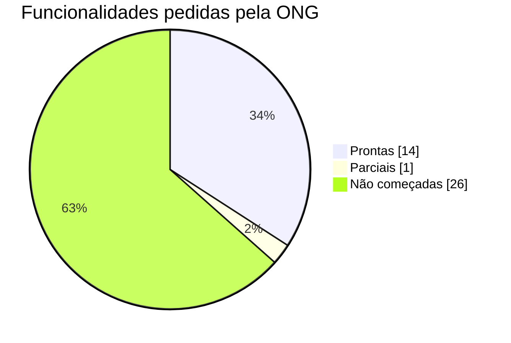

# Situação do sistema

Comparação entre **o que a ONG pediu** e **o que o sistema já faz**.
Atualizado em **14/11/2026**. Use este documento para priorizar.

Legenda: ✅ pronto · 🟡 parcial · ⬜ não começou · ❓ depende de decisão
(ver [legenda](README.md#legenda-de-status)).

## Resumo

> Contagem das 41 linhas das tabelas abaixo. **O núcleo de cadastros está pronto** (pessoas, famílias, alunos,
> formações, voluntários); **o que falta é o que gera valor operacional**: presença, materiais, cálculos de
> benefício, perfis de acesso e indicadores.

## Cadastros

| Funcionalidade                                                         | Status | Observação                                                                         |
|------------------------------------------------------------------------|--------|------------------------------------------------------------------------------------|
| Cadastro e listagem de **pessoas físicas**                             | ✅      |                                                                                    |
| Cadastro e listagem de **empresas/escolas**                            | ✅      | Com endereço e representante                                                       |
| Cadastro e listagem de **grupos familiares**                           | ✅      | Com renda, despesas, moradores                                                     |
| Vincular pessoas à família (nova ou existente)                         | ✅      | Busca da pessoa por CPF, RG, nome ou apelido                                       |
| Cadastro de **aluno** com responsáveis, escola, série, bolsa           | ✅      |                                                                                    |
| Cadastrar responsável **dentro** do cadastro do aluno                  | ✅      |                                                                                    |
| Cadastro de aluno em **etapas (steps)**                                | ✅      |                                                                                    |
| **Desistência e retorno** do aluno, com motivo e data                  | ✅      |                                                                                    |
| **Pais/responsáveis como alunos**                                      | ✅      |                                                                                    |
| Cadastro de **formações (turmas)** com dias, horários e séries         | ✅      | Nome da turma é automático                                                         |
| **Matricular alunos** em formações                                     | ✅      | Vários alunos por turma; um aluno em várias turmas                                 |
| **Voluntários** na formação, com função                                | ✅      | Funções vêm do programa                                                            |
| Cadastro de **programas** e **séries**                                 | ✅      |                                                                                    |
| **Renda de cada responsável** e sua origem (salário, pensão, autônomo) | ⬜      | Hoje só há a renda da família                                                      |
| **Documentos e termos** do aluno (upload)                              | ⬜      | Termo de compromisso e autorização de imagem; serão guardados no **drive interno** |
| **Disponibilidade** do aluno e do voluntário                           | ⬜      | Base da alocação nas formações                                                     |

## Cálculos e benefícios

Fórmulas **definidas** pela ONG ([detalhes](beneficios-e-calculos.md)); falta implementar.

| Funcionalidade                                                  | Status | Observação                                                              |
|-----------------------------------------------------------------|--------|-------------------------------------------------------------------------|
| **Renda líquida per capita** automática                         | ⬜      | `(renda − educação − habitação − saúde) ÷ moradores`; hoje é digitada   |
| **IHE** (Índice de Hipossuficiência Econômica)                  | ⬜      | Min–Max com pesos 50/50; precisa definir a base (a confirmar com a ONG) |
| **Vaquinha** com desconto por faixa de 20%                      | ⬜      | 100/80/60/20/0%                                                         |
| **Flag "boleto da vaquinha gerado"**                            | ⬜      | Congela o valor de quem já teve o boleto                                |
| **Vale-transporte** proporcional ao IHE                         | ⬜      | Total informado em parâmetro                                            |
| **Tela de parâmetros gerais** (totais de vaquinha e transporte) | ⬜      | Acesso da Administração                                                 |
| **Geração do boleto** da vaquinha                               | ⬜      |                                                                         |
| Regra de **renovação** pela participação                        | ⬜      | Depende de presença                                                     |
| **Período de cadastro** (set–nov)                               | ⬜      |                                                                         |

## Presença e materiais

| Funcionalidade                                                 | Status | Observação                          |
|----------------------------------------------------------------|--------|-------------------------------------|
| **Lista de presença digital** por aula                         | ⬜      | Hoje: papel + Excel                 |
| **Alertas de faltas** recorrentes                              | ⬜      |                                     |
| **Cadastro de materiais** (título, tipo, valor, quantidade)    | ⬜      |                                     |
| **Estoque**, **lista por série**, **orçamentos**, **editoras** | ⬜      |                                     |
| **Entrega** de materiais e vale-transporte por aluno           | ⬜      | Com registro de assinatura/retirada |

## Acesso, comunicação e relatórios

| Funcionalidade                                       | Status | Observação                                                                                                                                                                                             |
|------------------------------------------------------|--------|--------------------------------------------------------------------------------------------------------------------------------------------------------------------------------------------------------|
| **Login** seguro, recuperação de senha               | ✅      | Com confirmação de e-mail para pessoas                                                                                                                                                                 |
| **Perfis**: Administração, Secretaria, Professores   | 🟡     | Só existe Administração, e sem restrições                                                                                                                                                              |
| **Avisos por e-mail** às famílias                    | ⬜      | Hoje só e-mails automáticos (senha, confirmação)                                                                                                                                                       |
| **Feedback** dos responsáveis ligado ao aluno        | ⬜      | Hoje no Google Forms                                                                                                                                                                                   |
| **Painel de pendências**                             | ⬜      |                                                                                                                                                                                                        |
| **Indicadores** (operacionais, financeiros, impacto) | ⬜      | [Lista completa](indicadores-e-relatorios.md)                                                                                                                                                          |
| **Exportação** PDF/Excel                             | ⬜      |                                                                                                                                                                                                        |
| **Previsões** (materiais, evasão, voluntários)       | ⬜      | Fase posterior — precisa de histórico                                                                                                                                                                  |
| **Drive interno** do Projeto Resgate                 | ⬜      | Armazenar documentos (do aluno, termos, documentação do projeto) e outros arquivos; [detalhes](cadastros.md#drive-interno). Substitui a integração com o Google Drive prevista na Proposta de Melhoria |
| Integração com **DoeFácil** (doações)                | ⬜      | Hoje é feita por API em outro sistema                                                                                                                                                                  |
| **Migração** dos dados do Access e do EVN            | ⬜      | Fonte oficial e exportações a combinar com a ONG                                                                                                                                                       |
