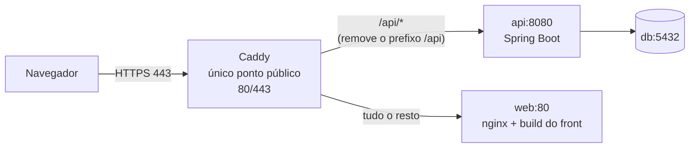

# Publicar o front e ligá-lo à API

> **Status:** guia de implantação. Os arquivos descritos aqui (Dockerfile, `nginx.conf`, workflow, `Caddyfile` e
> serviços do compose) **ainda não foram criados** nos repositórios, e esta configuração **ainda não foi
> testada de ponta a ponta**. O que já está testado é a parte da API (imagem, compose, CORS, health).

O front (`projetoresgate-app`) é uma SPA **Vite + React**. Ele usa a mesma estrutura da API: imagem no Docker Hub,
publicada por GitHub Actions, e o **Watchtower** na VM atualiza o container quando sai uma imagem nova.

## Desenho



| Peça    | Papel                                                                                             |
|---------|---------------------------------------------------------------------------------------------------|
| Caddy   | Recebe tudo, faz o **HTTPS automático** (certificado grátis) e roteia por caminho                  |
| web     | Container nginx que serve os arquivos estáticos do front e faz o *fallback* do React Router        |
| api     | A API atual. **Deixa de publicar a porta 8080** e passa a ser acessada só pela rede interna        |
| db      | Postgres, como hoje                                                                                |

**Por que um domínio só (`/` e `/api`):** front e API ficam na **mesma origem**. Não há problema de CORS, e o
cookie de refresh (`HttpOnly`, `SameSite`) funciona sem configuração especial. A API não tem prefixo `/api`; o
Caddy remove esse prefixo antes de repassar.

## O que você precisa providenciar

| Item                         | Detalhe                                                                                          |
|------------------------------|--------------------------------------------------------------------------------------------------|
| **Domínio ou subdomínio**    | Apontando (registro `A`) para o IP da VM. Serve um subdomínio grátis, como o DuckDNS              |
| **Portas 80 e 443 abertas**  | A empresa dona da VM precisa liberar. O Caddy usa a 80 para emitir o certificado                 |
| **Repositório no Docker Hub**| Um para o front, ex.: `seuusuario/projetoresgate-app`                                            |

Sem domínio, dá para testar por IP em HTTP (ver [teste sem domínio](#teste-sem-domínio-só-por-ip)).

## 1. No repositório do front

### 1.1 Apontar o axios para `/api`

Em `src/api/api.ts` o `baseURL` hoje é um valor de exemplo (`https://reqres.in`). Troque por:

```ts
export const api = axios.create({
    baseURL: import.meta.env.VITE_API_URL ?? "/api",
    withCredentials: true,
});
```

Em desenvolvimento local, crie um `.env.local` com `VITE_API_URL=http://localhost:8080` (a API local libera CORS
para o perfil `dev`).

### 1.2 `Dockerfile`

```dockerfile
FROM node:22-alpine AS build
WORKDIR /app
COPY package.json package-lock.json ./
RUN npm ci
COPY . .
RUN npm run build

FROM nginx:1.27-alpine
COPY nginx.conf /etc/nginx/conf.d/default.conf
COPY --from=build /app/dist /usr/share/nginx/html
EXPOSE 80
HEALTHCHECK --interval=30s --timeout=5s --retries=3 CMD wget -qO- http://127.0.0.1/ || exit 1
```

### 1.3 `nginx.conf`

```nginx
server {
    listen 80;
    server_name _;
    root /usr/share/nginx/html;
    index index.html;

    gzip on;
    gzip_types text/css application/javascript application/json image/svg+xml;

    location /assets/ {
        expires 1y;
        add_header Cache-Control "public, immutable";
    }

    location / {
        try_files $uri $uri/ /index.html;
        add_header Cache-Control "no-cache";
    }
}
```

O `try_files ... /index.html` é obrigatório: sem ele, recarregar a página em `/turmas` (uma rota do React Router)
devolve 404 do nginx.

### 1.4 `.github/workflows/deploy.yml` (mesmo padrão da API)

```yaml
name: Deploy - Projeto Resgate App

on:
  workflow_dispatch:
    inputs:
      ref:
        description: 'Branch, tag ou SHA a ser deployado'
        required: false
        default: 'main'

permissions:
  contents: read

concurrency:
  group: deploy-production-app
  cancel-in-progress: false

env:
  IMAGE_REPO: ${{ vars.DOCKER_IMAGE_REPO }}

jobs:
  resolve:
    runs-on: ubuntu-latest
    outputs:
      sha: ${{ steps.sha.outputs.sha }}
      tag: ${{ steps.sha.outputs.tag }}
    steps:
      - uses: actions/checkout@v4
        with:
          ref: ${{ inputs.ref }}
      - id: sha
        run: |
          SHA=$(git rev-parse HEAD)
          echo "sha=$SHA" >> "$GITHUB_OUTPUT"
          echo "tag=prod-${SHA::12}" >> "$GITHUB_OUTPUT"

  check:
    needs: resolve
    runs-on: ubuntu-latest
    steps:
      - uses: actions/checkout@v4
        with:
          ref: ${{ needs.resolve.outputs.sha }}
      - uses: actions/setup-node@v4
        with:
          node-version: '22'
          cache: npm
      - run: npm ci
      - run: npm run lint
      - run: npm run build

  build-and-push:
    needs: [resolve, check]
    runs-on: ubuntu-latest
    environment: production
    steps:
      - uses: actions/checkout@v4
        with:
          ref: ${{ needs.resolve.outputs.sha }}
      - uses: docker/login-action@v3
        with:
          username: ${{ secrets.DOCKERHUB_USERNAME }}
          password: ${{ secrets.DOCKERHUB_TOKEN }}
      - uses: docker/setup-buildx-action@v3
      - uses: docker/build-push-action@v6
        with:
          context: .
          push: true
          tags: |
            ${{ env.IMAGE_REPO }}:${{ needs.resolve.outputs.tag }}
            ${{ env.IMAGE_REPO }}:latest
          labels: |
            org.opencontainers.image.revision=${{ needs.resolve.outputs.sha }}
          cache-from: type=gha
          cache-to: type=gha,mode=max
```

No GitHub **do front**: variável `DOCKER_IMAGE_REPO` (`seuusuario/projetoresgate-app`), secrets `DOCKERHUB_USERNAME`
e `DOCKERHUB_TOKEN`, e o environment `production` (com aprovação), igual ao da API. Veja
[pipeline-ci-cd.md](pipeline-ci-cd.md#configuração-necessária-no-github).

Como o `VITE_API_URL` não é definido no build, o front usa `/api` (o padrão do `api.ts`).

## 2. Na VM

### 2.1 `Caddyfile` (ao lado do compose)

```
seu-dominio.com {
    encode gzip

    handle_path /api/* {
        reverse_proxy api:8080
    }

    handle {
        reverse_proxy web:80
    }
}
```

`handle_path` remove o `/api` do caminho. Então `https://seu-dominio.com/api/user/login` chega à API como `/user/login`.

### 2.2 Compose

No `docker-compose.prod.yml` da VM:

1. **Remova** `ports: - "8080:8080"` do serviço `api`. Ele deixa de ser público.
2. **Acrescente** os serviços `web` e `caddy`, e o volume do Caddy:

```yaml
  web:
    image: ${DOCKER_IMAGE_REPO_APP}:latest
    restart: unless-stopped
    labels:
      - com.centurylinklabs.watchtower.enable=true

  caddy:
    image: caddy:2-alpine
    restart: unless-stopped
    depends_on:
      - api
      - web
    ports:
      - "80:80"
      - "443:443"
    volumes:
      - ./Caddyfile:/etc/caddy/Caddyfile:ro
      - caddy_data:/data
      - caddy_config:/config

volumes:
  postgres_data:
  caddy_data:
  caddy_config:
```

O `caddy_data` guarda os certificados: **não o apague**, ou o Caddy pedirá certificados novos a cada subida e pode
bater no limite do Let's Encrypt.

### 2.3 `.env` da VM

Acrescente e ajuste:

```
DOCKER_IMAGE_REPO_APP=seuusuario/projetoresgate-app
FRONTEND_URL=https://seu-dominio.com
CORS-ALLOWED-ORIGINS=https://seu-dominio.com
API_RATE_LIMIT_TRUSTED_PROXIES=1
```

- **`API_RATE_LIMIT_TRUSTED_PROXIES=1`** é essencial. Com o Caddy na frente, todos chegam à API pelo IP do Caddy.
  Sem esse valor o limite por IP trata todos os usuários como **um só** e bloqueia todo mundo junto (429 geral).
- `FRONTEND_URL` é a base dos links dos e-mails de reset de senha e confirmação.
- Mantenha `API_COOKIE_SECURE` no padrão (`true`) e `API_COOKIE_SAME_SITE` no padrão (`Strict`): como o front e a
  API estão na mesma origem, funciona.

### 2.4 Firewall

```bash
sudo ufw allow 80/tcp
sudo ufw allow 443/tcp
sudo ufw delete allow 8080/tcp
```

### 2.5 Subir

```bash
cd ~/projetoresgate
docker compose -f docker-compose.prod.yml up -d
docker compose -f docker-compose.prod.yml logs -f caddy
```

Procure no log do Caddy a linha de certificado obtido (`certificate obtained successfully`).

## 3. Conferir

```bash
curl https://seu-dominio.com/api/actuator/health
```

Deve responder `{"groups":["liveness","readiness"],"status":"UP"}`. Depois abra `https://seu-dominio.com` no
navegador, entre com o usuário administrador e confira que o login se mantém ao recarregar a página.

## O fluxo de uma atualização do front

1. Você dispara o **Deploy** no GitHub do front: lint, build, e (após aprovação) push de `:latest` e `:prod-<sha>`.
2. Em até 5 minutos o **Watchtower** vê a imagem nova e recria o container `web`.
3. O Caddy continua servindo, e o container novo assume.

## Teste sem domínio (só por IP)

Útil para validar antes de ter domínio. **Não use em produção**, porque o tráfego e o login ficam sem criptografia.

`Caddyfile`:

```
:80 {
    encode gzip

    handle_path /api/* {
        reverse_proxy api:8080
    }

    handle {
        reverse_proxy web:80
    }
}
```

No `.env`: `API_COOKIE_SECURE=false`, `FRONTEND_URL=http://<IP-da-VM>` e `CORS-ALLOWED-ORIGINS=http://<IP-da-VM>`.
Em seguida abra a porta 80 no firewall. Volte `API_COOKIE_SECURE` para `true` quando tiver o domínio e o HTTPS.

## Problemas comuns

| Sintoma                                                  | Causa provável                                              | O que fazer                                                       |
|----------------------------------------------------------|-------------------------------------------------------------|-------------------------------------------------------------------|
| Caddy não emite o certificado                            | Domínio não aponta para a VM, ou a porta 80/443 está fechada | `dig seu-dominio.com`; confirme as portas com a empresa da VM; `docker compose logs caddy` |
| Recarregar `/turmas` dá 404                              | Falta o `try_files ... /index.html` no `nginx.conf`         | Corrigir o `nginx.conf` e republicar o front                      |
| Login funciona e some ao recarregar                      | Cookie descartado (sem HTTPS com `API_COOKIE_SECURE=true`)  | Usar HTTPS, ou o [teste sem domínio](#teste-sem-domínio-só-por-ip) |
| Todos os usuários recebem 429 ao mesmo tempo             | Falta `API_RATE_LIMIT_TRUSTED_PROXIES=1`                    | Definir no `.env` e `docker compose up -d`                        |
| O front chama `reqres.in` ou `localhost`                 | `baseURL` não foi trocado em `api.ts`                       | Ver [1.1](#11-apontar-o-axios-para-api)                           |
| `/api/...` devolve 404 do nginx do front                 | Caddy sem o bloco `handle_path /api/*`                      | Conferir o `Caddyfile`                                            |
| Links de e-mail abrem em `localhost`                     | `FRONTEND_URL` não configurado                              | Definir no `.env` e recriar a API                                 |
