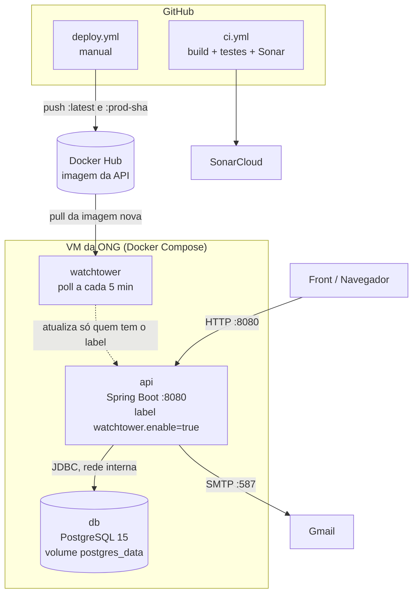
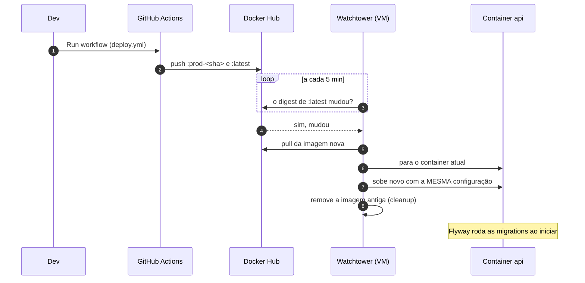

# Infraestrutura e deploy

A aplicação roda em **uma única VM** cedida por uma empresa parceira (acesso por IP, porta, usuário e senha —
sem nuvem gerenciada). Tudo roda em Docker na própria VM. Por ser um favor, a VM pode **mudar ou sumir sem
aviso**: por isso a [seção de backup](#backup) é a parte mais importante deste documento.

## Arquitetura atual



Este repositório entrega **só o back**. Front e proxy reverso ficam para uma etapa seguinte (ver
[evolução](#evolução-prevista)).

## Arquivos de deploy

| Arquivo                                                                  | Papel                                                          |
|--------------------------------------------------------------------------|----------------------------------------------------------------|
| [`deploy/docker-compose.prod.yml`](../../deploy/docker-compose.prod.yml) | Sobe `db`, `api` e `watchtower` na VM                          |
| [`deploy/.env.example`](../../deploy/.env.example)                       | Modelo do `.env` (segredos) — **o `.env` real nunca vai ao git** |
| [`Dockerfile`](../../Dockerfile)                                         | Imagem da API (multi-stage)                                    |
| `docker-compose.yml` (raiz)                                              | **Só desenvolvimento local** (banco + migrations + seed)       |

> Não confunda: o `docker-compose.yml` da raiz **não** é o de produção. Ele inclui o seed com senhas de
> exemplo e expõe a porta 5432.

## Como o Watchtower atualiza a API



Pontos importantes:

- **`WATCHTOWER_LABEL_ENABLE=true`**: só containers com o label `com.centurylinklabs.watchtower.enable=true`
  são atualizados. O **banco nunca** é tocado.
- **Migrations** rodam dentro da própria API (`spring.flyway.enabled=true`) no start. Uma migration
  quebrada **derruba a API no boot** — e o Watchtower não faz rollback. Ver [ADR 003](../adr/003-gerenciamento-banco-dados.md).
- **Sem health check nem rollback automático.** Se a imagem nova não subir, o container fica em loop de
  restart. Valide sempre após o deploy ([runbook](runbook.md#validar-um-deploy)).
- O `watchtower` usa o fork **`nickfedor/watchtower`**; o repositório original (`containrrr`) foi arquivado.
  Confirme que o fork segue ativo ao revisar o projeto.
- O Watchtower monta `/var/run/docker.sock` — isso equivale a **acesso root** ao Docker. É o padrão da
  ferramenta; mantenha a VM atualizada e o SSH restrito.

## Setup inicial da VM (uma vez)

### 1. Preparar o sistema

```bash
# Docker
curl -fsSL https://get.docker.com | sh

# Usuário dedicado (não use root nem o usuário principal da VM)
sudo adduser deploy
sudo usermod -aG docker deploy

# Firewall: só SSH e a porta da API
sudo apt install -y ufw fail2ban unattended-upgrades
sudo ufw allow 22/tcp
sudo ufw allow 8080/tcp
sudo ufw enable
```

### 2. Trocar senha SSH por chave

```bash
# na sua máquina
ssh-copy-id deploy@<IP>
# depois, na VM, em /etc/ssh/sshd_config:
#   PasswordAuthentication no
#   PermitRootLogin no
sudo systemctl restart ssh
```

> Teste o login por chave **em outra janela** antes de fechar a sessão atual, para não se trancar fora.

### 3. Subir a aplicação

```bash
# como usuário deploy
mkdir -p ~/projetoresgate && cd ~/projetoresgate
# copie para cá: deploy/docker-compose.prod.yml e deploy/.env.example
cp .env.example .env
nano .env                      # preencha os valores reais (ver tabela abaixo)
chmod 600 .env
docker compose -f docker-compose.prod.yml up -d
docker compose -f docker-compose.prod.yml logs -f api
```

Se a imagem for **privada** no Docker Hub, faça `docker login` antes e descomente `REPO_USER`/`REPO_PASS`
no serviço `watchtower`. Se for pública, não precisa de nada.

## Variáveis de ambiente (`.env` na VM)

| Variável                       | Obrigatória | Descrição                                                                 |
|--------------------------------|-------------|---------------------------------------------------------------------------|
| `DOCKER_IMAGE_REPO`            | sim         | Imagem da API (ex.: `seuuser/projetoresgate-api`)                         |
| `DB_USERNAME` / `DB_PASSWORD`  | sim         | Credenciais do Postgres (usadas pelo `db` **e** pela API)                 |
| `API_SECURITY_TOKEN_SECRET`    | sim         | Segredo do JWT. Longo e aleatório: `openssl rand -base64 48`              |
| `FRONTEND_URL`                 | sim         | URL base do front, usada nos links dos e-mails de reset de senha e confirmação (ex.: `https://app.exemplo.org`) |
| `CORS-ALLOWED-ORIGINS`         | sim         | Origem(ns) do front. **O nome tem hífen** (como está no `application.yaml`) |
| `MAIL_USERNAME` / `MAIL_PASSWORD` | sim      | Conta SMTP do Gmail (use **senha de app**, não a senha da conta)          |
| `API_USER_REGISTRATION_PUBLIC` | não         | `false` por padrão. **Nunca** coloque `true` em produção: liberaria criar administradores sem login |
| `API_COOKIE_SECURE`            | não         | `true` por padrão. Sem HTTPS, o navegador **descarta** o cookie de refresh |
| `API_COOKIE_SAME_SITE`         | não         | `Strict` por padrão                                                       |
| `API_RATE_LIMIT_TRUSTED_PROXIES` | não       | Padrão `0`. **Defina `1` quando houver proxy reverso (Caddy/Nginx) na frente da API**; sem isso o limite por IP trata todos os usuários como um só |
| `API_DOCS_ENABLED`             | não         | `false` por padrão: **Swagger e `api-docs` ficam desligados em produção** (respondem 401). Só ligue para depuração pontual |
| `APP_MAIL_MAX_ATTEMPTS` / `APP_MAIL_RETRY_DELAY_SECONDS` / `APP_MAIL_RETRY_BACKOFF_MULTIPLIER` | não | Reenvio de e-mail: padrão **3 tentativas**, 10 s de espera e multiplicador 4 (10 s, 40 s) |
| `BACKUP_REMOTE`                | não         | Destino do `rclone` para o [backup](#backup). O `.env.example` traz `remoto:projetoresgate-backups` (Google Drive; exige o [`rclone config`](#enviar-o-backup-para-o-google-drive-rclone) na VM). Vazio = só local |
| `API_RATE_LIMIT_*`             | não         | Limites por camada e por e-mail (padrões: login 5/min, público 20/min, geral 300/min, e-mail 3/h). Lista completa em [`tecnico/autenticacao.md`](../tecnico/autenticacao.md#variáveis-do-limite) |

`DB_URL` é definido no próprio compose (`jdbc:postgresql://db:5432/projetoresgatedb`).

> **Variável com hífen.** O `application.yaml` lê `CORS-ALLOWED-ORIGINS` (com hífen). Foi testado com o
> `docker-compose.prod.yml` real: o `env_file` entrega a variável ao container, a API sobe e aplica o CORS
> (origem configurada recebe `Access-Control-Allow-Origin`; outras recebem 403). Como o hífen não é um nome
> válido no bash, **não use `. ./.env`** para carregar esse arquivo em scripts: leia só a variável que precisa
> (`grep '^NOME=' .env | cut -d= -f2-`), como fazem os scripts de backup.

### E-mail (reset de senha e confirmação)

- O envio acontece **só depois do commit** da transação (se a operação falhar, nenhum e-mail sai).
- Se o SMTP falhar, há **reenvio** com espera crescente (padrão 3 tentativas: 10 s e 40 s). Erros permanentes
  (autenticação, endereço inválido) **não** são repetidos.
- O log mascara o destinatário (`a***@dominio.com`). Métrica Micrometer `mail.delivery` com `result` = `success`,
  `retry` ou `failure` (em `/actuator/prometheus`, exige login).
- Há limite de **3 e-mails por hora por destinatário**, que descarta em silêncio o excedente.
- Timeouts de conexão e envio SMTP estão configurados; uma falha de SMTP não derruba o healthcheck.

### Saúde e desligamento

- `/actuator/health` (e `/liveness`, `/readiness`) é **público** e devolve só o status. Prometheus e `info` exigem login.
- O indicador de saúde de e-mail está desligado: a queda do SMTP não marca a API como `DOWN`.
- O desligamento é **gracioso** (até 25 s por fase); o compose espera 40 s antes de matar o container.

## Backup

A VM é emprestada e o banco é o único dado insubstituível. **Faça backup fora da VM.**

Os scripts ficam em `deploy/` e vão para a VM junto com o compose (`~/projetoresgate/`):

| Script                | O que faz                                                                                       |
|-----------------------|-------------------------------------------------------------------------------------------------|
| `deploy/backup.sh`    | Gera `~/backups/projetoresgate_AAAA-MM-DD_HHMMSS.sql.gz`, valida o arquivo, envia ao destino externo (se `BACKUP_REMOTE` estiver definido) e apaga os mais antigos |
| `deploy/restore.sh`   | Restaura um arquivo no banco, pedindo confirmação. Para a API durante a restauração e a religa  |

**Backup manual**, quando quiser (antes de um deploy arriscado, por exemplo):

```bash
cd ~/projetoresgate && ./backup.sh
```

**Backup automático**, em `crontab -e` (**uma vez por dia**, às 3h, mantendo os **7 últimos** na VM). O `nice` e o `ionice`
fazem o backup rodar com a menor prioridade de CPU e disco, para não pesar numa VM limitada:

```cron
0 3 * * * nice -n 19 ionice -c3 ~/projetoresgate/backup.sh >> ~/backups/backup.log 2>&1
```

Variáveis do backup, no **`.env` da VM** (`~/projetoresgate/.env`; não são do GitHub). O `backup.sh` as lê desse arquivo, e o `.env.example` já traz os valores abaixo. Uma variável definida no ambiente do comando tem prioridade sobre o `.env`:

| Variável                  | Padrão no script | Para que serve                                                        |
|---------------------------|------------------|-----------------------------------------------------------------------|
| `BACKUP_REMOTE`           | vazio            | Destino do `rclone`, ex.: `remoto:projetoresgate-backups`. Vazio = só local |
| `BACKUP_KEEP`             | `7`              | Quantos backups ficam na VM                                           |
| `BACKUP_REMOTE_KEEP_DAYS` | `14`             | Por quantos dias ficam no destino externo                             |
| `BACKUP_DIR`              | `~/backups`      | Pasta dos backups na VM (no `.env`, use o caminho completo, sem `~`)    |

### Enviar o backup para o Google Drive (rclone)

A VM não tem navegador, então a autorização do Google é feita **no seu computador** e o token é colado na VM.

1. **Instale o rclone** na VM e no seu computador:
   ```bash
   curl https://rclone.org/install.sh | sudo bash
   ```
2. **Na VM**, como o usuário que roda o cron (o `deploy`), rode `rclone config` e responda:

   | Pergunta                                 | Resposta                                                                 |
   |------------------------------------------|--------------------------------------------------------------------------|
   | `n/s/q`                                  | `n` (novo remoto)                                                         |
   | `name`                                   | `remoto`                                                                  |
   | `Storage`                                | `drive` (Google Drive)                                                    |
   | `client_id` e `client_secret`            | Enter (vazio)                                                             |
   | `scope`                                  | `3` (`drive.file`: só enxerga os arquivos que o rclone criou, não o resto do Drive) |
   | `service_account_file`, `root_folder_id` | Enter (vazio)                                                             |
   | `Edit advanced config`                   | `n`                                                                       |
   | `Use auto config`                        | **`n`** (a VM não tem navegador)                                          |

   O rclone mostra um comando como `rclone authorize "drive" "eyJ..."`.
3. **No seu computador**, rode esse comando. O navegador abre, você entra na conta do Google e autoriza. O
   terminal imprime um **token** (um bloco `{"access_token":...}`).
4. **Na VM**, cole o token onde o rclone pediu (`config_token>`), responda `n` para *Team Drive* e `y` para
   confirmar. Termine com `q`.
5. **Teste:**
   ```bash
   rclone mkdir remoto:projetoresgate-backups
   rclone lsd remoto:
   echo teste > /tmp/teste.txt && rclone copy /tmp/teste.txt remoto:projetoresgate-backups
   rclone ls remoto:projetoresgate-backups
   ```
   O arquivo `teste.txt` deve aparecer na pasta `projetoresgate-backups` do Google Drive.
6. **Ligue no backup**, no `.env` da VM:
   ```
   BACKUP_REMOTE=remoto:projetoresgate-backups
   ```
   Rode `./backup.sh` à mão uma vez e confirme que o arquivo foi para o Drive.

O `deploy/.env.example` já vem com `BACKUP_REMOTE=remoto:projetoresgate-backups`, que assume um remoto do rclone
chamado `remoto` (o nome do passo 2) e a pasta `projetoresgate-backups` no Drive. Se você usar outro nome de remoto ou
de pasta, ajuste o valor. **Sem o `rclone config` feito na VM, o envio falha** (o `backup.sh` termina com erro depois
de gerar o arquivo local). Para não enviar nada para fora, deixe `BACKUP_REMOTE=` vazio.

Cuidados:
- **Use uma conta do Google da ONG**, não a pessoal. Se a pessoa sair, o backup não pode depender dela.
- O token fica em `~/.config/rclone/rclone.conf`. Dê `chmod 600` nesse arquivo: quem o ler acessa os arquivos criados
  pelo rclone (com o escopo `drive.file`, o resto do Drive fica protegido).
- Se o cron deixar de enviar (token revogado ou expirado), o `backup.log` mostra o erro do rclone. Refaça o passo 3 e
  atualize com `rclone config reconnect remoto:`.
- Outros destinos (Backblaze B2, Cloudflare R2) seguem o mesmo `rclone config`, só muda o tipo de armazenamento. O B2 e
  o R2 não exigem token de navegador, só chaves de acesso.

**Envio para fora da VM (resumo):** instale o `rclone`, rode `rclone config` para criar um destino chamado `remoto`
(Google Drive, Backblaze B2 ou Cloudflare R2) e coloque `BACKUP_REMOTE=remoto:projetoresgate-backups` no `.env`.

**Restaurar** (apaga o banco atual):

```bash
cd ~/projetoresgate && ./restore.sh ~/backups/projetoresgate_AAAA-MM-DD_HHMMSS.sql.gz
```

> Um backup que nunca foi restaurado é uma esperança, não um backup. **Teste a restauração** num
> ambiente local ao menos uma vez e depois a cada poucos meses.

## Reconstruir a VM do zero

Se a VM for trocada, o que você precisa ter **fora dela**:

| Item                              | Onde guardar                                         |
|-----------------------------------|------------------------------------------------------|
| `docker-compose.prod.yml`         | Neste repositório (`deploy/`)                        |
| `.env` (segredos reais)           | Gerenciador de senhas — **não** no git               |
| Último backup do banco            | Armazenamento externo (rclone)                       |
| Imagem da API                     | Docker Hub (reconstruível pelo `deploy.yml`)         |

Procedimento: [setup inicial](#setup-inicial-da-vm-uma-vez) → restaurar o backup → `up -d`.
Como o Flyway é idempotente, restaurar um dump **e** subir a API é seguro.

## Evolução prevista

| Item                                     | Observação                                                                       |
|------------------------------------------|----------------------------------------------------------------------------------|
| **Domínio + HTTPS (Caddy)**              | Hoje a API expõe `:8080` em HTTP. O cookie de refresh é `Secure`, então **o login no navegador exige HTTPS**. Passo a passo em [`frontend-deploy.md`](frontend-deploy.md). |
| Front no mesmo compose                   | Entra como mais um serviço atrás do proxy: ver [`frontend-deploy.md`](frontend-deploy.md). |
| Fechar a porta 8080 ao público           | Só o proxy (80/443) exposto; API e banco na rede interna.                        |
| Monitoramento externo                    | UptimeRobot (gratuito) apontando para a URL pública.                             |
| Alinhar versão do Postgres               | Dev usa 15, testes usam outra: [RFC 0002](../rfc/0002-alinhar-versao-postgres.md). |
