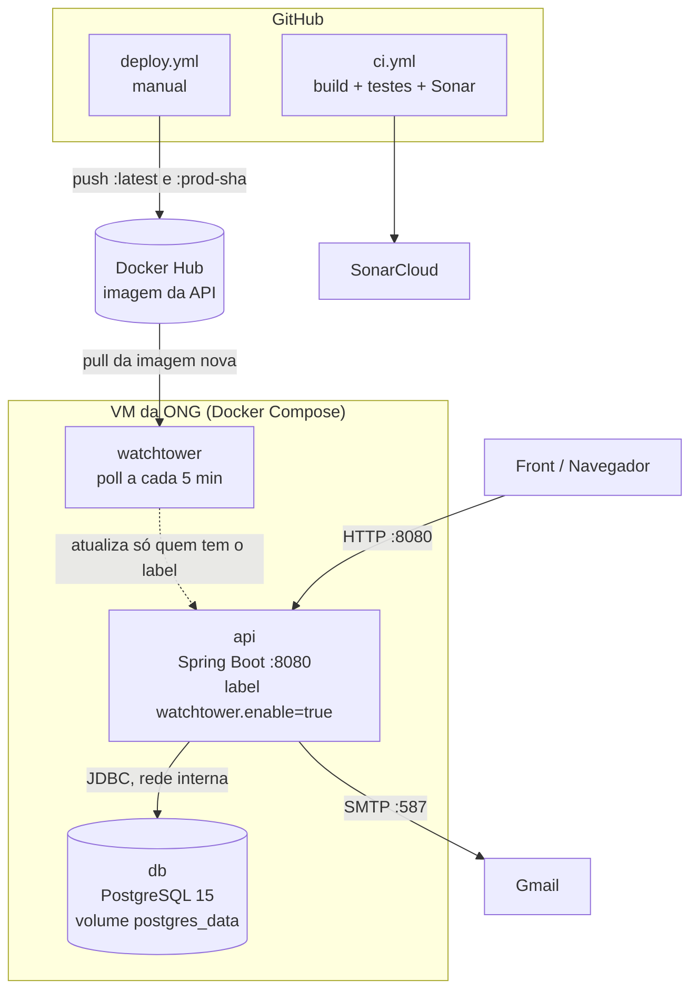
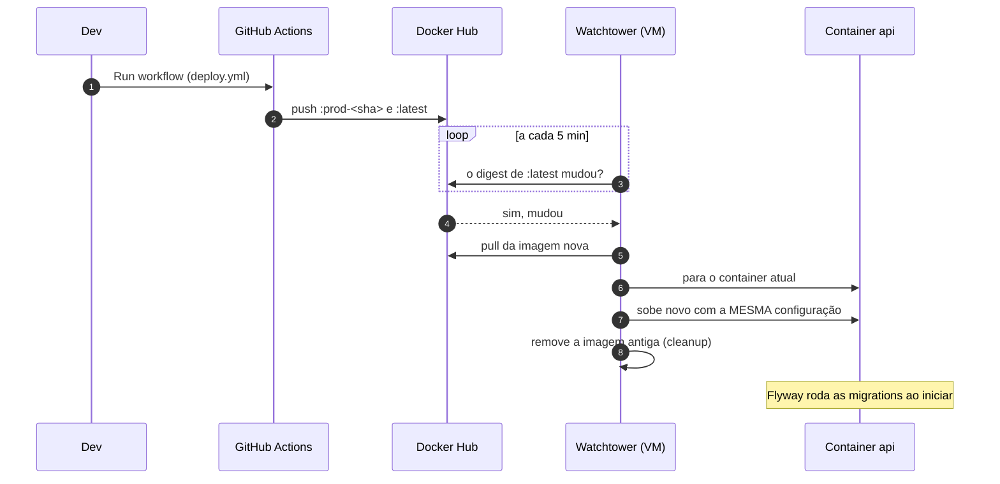

# Infraestrutura e deploy

A aplicação roda em **uma única VM** cedida por uma empresa parceira (acesso por IP, porta, usuário e senha —
sem nuvem gerenciada). Tudo roda em Docker na própria VM. Por ser um favor, a VM pode **mudar ou sumir sem
aviso**: por isso a [seção de backup](#backup) é a parte mais importante deste documento.

## Arquitetura atual



Este repositório entrega **só o back**. Front e proxy reverso ficam para uma etapa seguinte (ver
[evolução](#evolução-prevista)).

## Arquivos de deploy

| Arquivo                                                                  | Papel                                                          |
|--------------------------------------------------------------------------|----------------------------------------------------------------|
| [`deploy/docker-compose.prod.yml`](../../deploy/docker-compose.prod.yml) | Sobe `db`, `api` e `watchtower` na VM                          |
| [`deploy/.env.example`](../../deploy/.env.example)                       | Modelo do `.env` (segredos) — **o `.env` real nunca vai ao git** |
| [`Dockerfile`](../../Dockerfile)                                         | Imagem da API (multi-stage)                                    |
| `docker-compose.yml` (raiz)                                              | **Só desenvolvimento local** (banco + migrations + seed)       |

> Não confunda: o `docker-compose.yml` da raiz **não** é o de produção. Ele inclui o seed com senhas de
> exemplo e expõe a porta 5432.

## Como o Watchtower atualiza a API



Pontos importantes:

- **`WATCHTOWER_LABEL_ENABLE=true`**: só containers com o label `com.centurylinklabs.watchtower.enable=true`
  são atualizados. O **banco nunca** é tocado.
- **Migrations** rodam dentro da própria API (`spring.flyway.enabled=true`) no start. Uma migration
  quebrada **derruba a API no boot** — e o Watchtower não faz rollback. Ver [ADR 003](../adr/003-gerenciamento-banco-dados.md).
- **Sem health check nem rollback automático.** Se a imagem nova não subir, o container fica em loop de
  restart. Valide sempre após o deploy ([runbook](runbook.md#validar-um-deploy)).
- O `watchtower` usa o fork **`nickfedor/watchtower`**; o repositório original (`containrrr`) foi arquivado.
  Confirme que o fork segue ativo ao revisar o projeto.
- O Watchtower monta `/var/run/docker.sock` — isso equivale a **acesso root** ao Docker. É o padrão da
  ferramenta; mantenha a VM atualizada e o SSH restrito.

## Setup inicial da VM (uma vez)

### 1. Preparar o sistema

```bash
# Docker
curl -fsSL https://get.docker.com | sh

# Usuário dedicado (não use root nem o usuário principal da VM)
sudo adduser deploy
sudo usermod -aG docker deploy

# Firewall: só SSH e a porta da API
sudo apt install -y ufw fail2ban unattended-upgrades
sudo ufw allow 22/tcp
sudo ufw allow 8080/tcp
sudo ufw enable
```

### 2. Trocar senha SSH por chave

```bash
# na sua máquina
ssh-copy-id deploy@<IP>
# depois, na VM, em /etc/ssh/sshd_config:
#   PasswordAuthentication no
#   PermitRootLogin no
sudo systemctl restart ssh
```

> Teste o login por chave **em outra janela** antes de fechar a sessão atual, para não se trancar fora.

### 3. Subir a aplicação

```bash
# como usuário deploy
mkdir -p ~/projetoresgate && cd ~/projetoresgate
# copie para cá: deploy/docker-compose.prod.yml e deploy/.env.example
cp .env.example .env
nano .env                      # preencha os valores reais (ver tabela abaixo)
chmod 600 .env
docker compose -f docker-compose.prod.yml up -d
docker compose -f docker-compose.prod.yml logs -f api
```

Se a imagem for **privada** no Docker Hub, faça `docker login` antes e descomente `REPO_USER`/`REPO_PASS`
no serviço `watchtower`. Se for pública, não precisa de nada.

## Variáveis de ambiente (`.env` na VM)

| Variável                       | Obrigatória | Descrição                                                                 |
|--------------------------------|-------------|---------------------------------------------------------------------------|
| `DOCKER_IMAGE_REPO`            | sim         | Imagem da API (ex.: `seuuser/projetoresgate-api`)                         |
| `DB_USERNAME` / `DB_PASSWORD`  | sim         | Credenciais do Postgres (usadas pelo `db` **e** pela API)                 |
| `API_SECURITY_TOKEN_SECRET`    | sim         | Segredo do JWT. Longo e aleatório: `openssl rand -base64 48`              |
| `FRONTEND_URL`                 | sim         | URL base do front, usada nos links dos e-mails de reset de senha e confirmação (ex.: `https://app.exemplo.org`) |
| `CORS-ALLOWED-ORIGINS`         | sim         | Origem(ns) do front. **O nome tem hífen** (como está no `application.yaml`) |
| `MAIL_USERNAME` / `MAIL_PASSWORD` | sim      | Conta SMTP do Gmail (use **senha de app**, não a senha da conta)          |
| `API_USER_REGISTRATION_PUBLIC` | não         | `false` por padrão. **Nunca** coloque `true` em produção: liberaria criar administradores sem login |
| `API_COOKIE_SECURE`            | não         | `true` por padrão. Sem HTTPS, o navegador **descarta** o cookie de refresh |
| `API_COOKIE_SAME_SITE`         | não         | `Strict` por padrão                                                       |
| `API_RATE_LIMIT_MAX_REQUESTS`  | não         | Padrão 5 por janela                                                       |

`DB_URL` é definido no próprio compose (`jdbc:postgresql://db:5432/projetoresgatedb`).

> **Variável com hífen.** O `application.yaml` lê `CORS-ALLOWED-ORIGINS` (com hífen). Foi testado subindo o jar
> com a variável definida via `env 'CORS-ALLOWED-ORIGINS=...'`: a API sobe e aplica o CORS corretamente.
> O que **ainda não foi testado** é o `env_file` do Docker Compose. No primeiro deploy, confirme com
> `docker exec projetoresgate_api env | grep CORS`. Se a variável não chegar, a API não sobe (placeholder sem
> valor); a correção é renomear no `application.yaml` para `CORS_ALLOWED_ORIGINS`.

## Backup

A VM é emprestada e o banco é o único dado insubstituível. **Faça backup fora da VM.**

```bash
# ~/projetoresgate/backup.sh  (rodar via cron todo dia, ex.: 03:00)
#!/usr/bin/env bash
set -euo pipefail
STAMP=$(date +%F_%H%M)
OUT=~/backups/projetoresgate_$STAMP.sql.gz
mkdir -p ~/backups
docker exec projetoresgate_db pg_dump -U "$DB_USERNAME" projetoresgatedb | gzip > "$OUT"
# envie para FORA da VM (ex.: rclone para Google Drive / Backblaze B2 / R2)
rclone copy "$OUT" remoto:projetoresgate-backups/
# mantém só os 14 mais recentes localmente
ls -1t ~/backups/*.sql.gz | tail -n +15 | xargs -r rm --
```

```cron
0 3 * * * cd ~/projetoresgate && set -a && . ./.env && set +a && ./backup.sh >> ~/backups/backup.log 2>&1
```

**Restaurar** (num banco vazio):

```bash
gunzip -c projetoresgate_AAAA-MM-DD_HHMM.sql.gz | docker exec -i projetoresgate_db psql -U "$DB_USERNAME" projetoresgatedb
```

> Um backup que nunca foi restaurado é uma esperança, não um backup. **Teste a restauração** num
> ambiente local ao menos uma vez e depois a cada poucos meses.

## Reconstruir a VM do zero

Se a VM for trocada, o que você precisa ter **fora dela**:

| Item                              | Onde guardar                                         |
|-----------------------------------|------------------------------------------------------|
| `docker-compose.prod.yml`         | Neste repositório (`deploy/`)                        |
| `.env` (segredos reais)           | Gerenciador de senhas — **não** no git               |
| Último backup do banco            | Armazenamento externo (rclone)                       |
| Imagem da API                     | Docker Hub (reconstruível pelo `deploy.yml`)         |

Procedimento: [setup inicial](#setup-inicial-da-vm-uma-vez) → restaurar o backup → `up -d`.
Como o Flyway é idempotente, restaurar um dump **e** subir a API é seguro.

## Evolução prevista

| Item                                     | Observação                                                                       |
|------------------------------------------|----------------------------------------------------------------------------------|
| **Domínio + HTTPS (Caddy)**              | Hoje a API expõe `:8080` em HTTP. O cookie de refresh é `Secure`, então **o login no navegador exige HTTPS**. |
| Front no mesmo compose                   | Quando o front existir, entra como mais um serviço atrás do proxy.               |
| Fechar a porta 8080 ao público           | Só o proxy (80/443) exposto; API e banco na rede interna.                        |
| Monitoramento externo                    | UptimeRobot (gratuito) apontando para a URL pública.                             |
| Alinhar versão do Postgres               | Dev usa 15, testes usam outra: [RFC 0002](../rfc/0002-alinhar-versao-postgres.md). |
