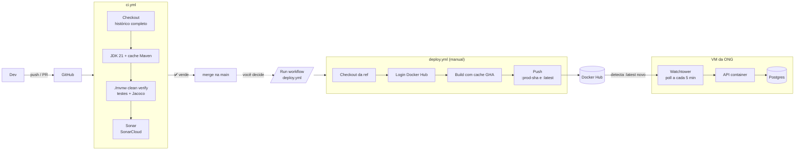
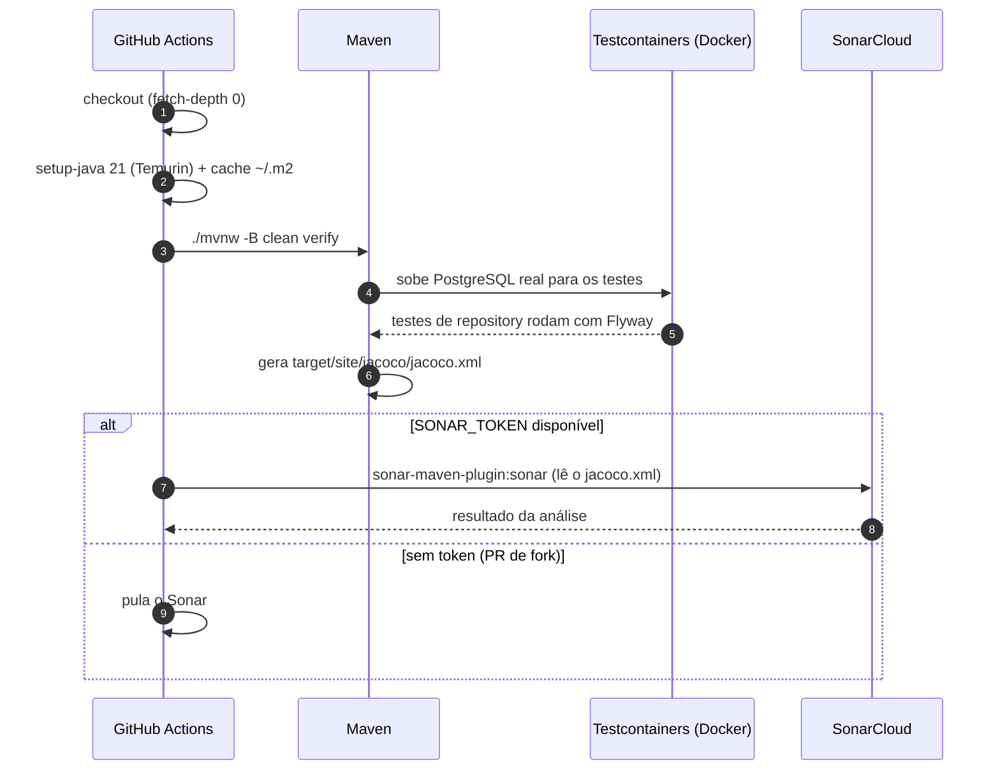
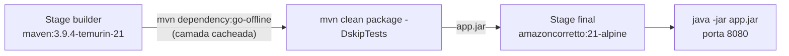

# Pipeline de CI/CD

Dois workflows no GitHub Actions, com responsabilidades separadas:

| Workflow                                          | Gatilho                                      | O que faz                                          |
|---------------------------------------------------|----------------------------------------------|----------------------------------------------------|
| [`ci.yml`](../../.github/workflows/ci.yml)        | push na `main`, PR, manual                   | Build, testes e análise no SonarCloud              |
| [`deploy.yml`](../../.github/workflows/deploy.yml)| **somente manual** (`workflow_dispatch`)     | Gera a imagem Docker e publica no Docker Hub       |

A **VM não é acessada pelo GitHub**. Quem atualiza o servidor é o **Watchtower**, rodando na própria VM, que
observa o Docker Hub e puxa a imagem nova. Detalhes em [`infraestrutura-deploy.md`](infraestrutura-deploy.md).

## Visão ponta a ponta

## `ci.yml` em detalhe

Por que cada escolha:

- **`fetch-depth: 0`** — o Sonar precisa do histórico para atribuir código novo × antigo.
- **`./mvnw`** — usa a versão do Maven fixada no repositório (`.mvn/`), igual para todo mundo.
- **Testcontainers** — os testes de banco usam PostgreSQL real, **sem H2** ([ADR 007](../adr/007-testcontainers-postgres.md)).
  O `ubuntu-latest` já traz Docker, então não há configuração extra.
- **Sonar condicional** — PRs vindos de fork não recebem secrets; sem a condição o job falharia.
- **`concurrency` com `cancel-in-progress`** — um push novo cancela a execução anterior da mesma ref,
  economizando minutos.

## `deploy.yml` em detalhe

Disparo: **Actions → Deploy - Projeto Resgate API → Run workflow**. O campo `ref` (padrão `main`) permite
escolher outra branch, tag ou SHA.

| Etapa                  | Detalhe                                                                                        |
|------------------------|------------------------------------------------------------------------------------------------|
| Checkout               | Na `ref` informada.                                                                            |
| Tag                    | `prod-<12 primeiros caracteres do SHA>` — identifica exatamente qual commit está na imagem.    |
| Login                  | `DOCKERHUB_USERNAME` + `DOCKERHUB_TOKEN` (token de acesso, não a senha).                       |
| Build                  | Usa o `Dockerfile` (multi-stage: Maven → Corretto 21 Alpine) com cache `type=gha`.             |
| Push                   | Duas tags: **`:prod-<sha>`** (imutável, serve de rollback) e **`:latest`** (o que o Watchtower observa). |
| `environment: production` | Permite exigir aprovação manual e restringir branches (ver [segurança](#segurança-do-pipeline)). |

> O deploy **não roda os testes**. Ele confia que o `ci.yml` já passou na mesma ref. Antes de disparar,
> confira que o último CI da `main` está verde. (Se quiser travar isso, dá para fazer o `deploy.yml`
> chamar o `ci.yml` como workflow reutilizável.)

### O `Dockerfile`

O `pom.xml` é copiado e as dependências baixadas **antes** do código-fonte, para que mudar só o código
reaproveite a camada de dependências. O `-DskipTests` aqui é intencional: os testes já rodaram no CI.

⚠️ O `Dockerfile` referencia o jar pelo nome `projetoresgate-api-0.0.1-SNAPSHOT.jar`. **Se a versão no
`pom.xml` mudar, o build da imagem quebra.**

## Configuração necessária no GitHub

### Secrets (`Settings → Secrets and variables → Actions`)

| Secret               | Usado em    | Para quê                                                       |
|----------------------|-------------|----------------------------------------------------------------|
| `SONAR_TOKEN`        | `ci.yml`    | Token do SonarCloud                                            |
| `DOCKERHUB_USERNAME` | `deploy.yml`| Usuário do Docker Hub                                          |
| `DOCKERHUB_TOKEN`    | `deploy.yml`| **Access token** do Docker Hub (permissão de leitura/escrita só no repositório da imagem) |

> Prefira guardar os dois do Docker Hub no **environment `production`** em vez do nível do repositório.

### Variables

| Variable             | Exemplo                       | Para quê                                 |
|----------------------|-------------------------------|------------------------------------------|
| `DOCKER_IMAGE_REPO`  | `seuusuario/projetoresgate-api` | Nome da imagem no Docker Hub           |
| `SONAR_PROJECT_KEY`  | `org_projetoresgate-api`      | Chave do projeto no SonarCloud           |
| `SONAR_ORGANIZATION` | `org`                         | Organização no SonarCloud                |

Os segredos da **aplicação** (banco, JWT, SMTP) **não** ficam no GitHub: ficam só no `.env` da VM.

## Segurança do pipeline

| Medida                                                             | Por quê                                                                                     |
|--------------------------------------------------------------------|---------------------------------------------------------------------------------------------|
| GitHub **não tem** credenciais da VM                               | Comprometer o repositório não dá acesso ao servidor nem ao banco.                           |
| Deploy só manual                                                   | Nada vai para produção sem uma pessoa decidir.                                              |
| Environment `production` com **Required reviewers**                | Um segundo olhar (ou o seu clique) antes de publicar. Configure em `Settings → Environments`. |
| Environment restrito à branch `main` (**Deployment branches**)     | Impede publicar e ler secrets a partir de uma branch arbitrária.                            |
| Proteção da `main` (PR obrigatório + CI verde)                     | Só código revisado e testado chega ao que é publicado por padrão.                           |
| Token do Docker Hub com escopo mínimo                              | Vazamento não expõe a conta inteira.                                                        |
| Nunca usar `pull_request_target` com secrets                       | Executaria código de PR de fork com acesso aos secrets.                                     |

## Como fazer um deploy

1. Garanta que o CI da `main` está ✅.
2. **Actions → Deploy → Run workflow** (deixe `ref = main`).
3. Aguarde o job terminar (≈ 3–6 min).
4. Aguarde até **5 minutos** (intervalo do Watchtower) e valide — ver [`runbook.md`](runbook.md#validar-um-deploy).

## Como fazer rollback

A VM roda `:latest`. Para voltar a uma versão anterior, aponte o compose para uma tag `prod-<sha>` antiga —
passo a passo em [`runbook.md`](runbook.md#rollback).

## Evoluções possíveis

| Ideia                                                  | Ganho                                            |
|--------------------------------------------------------|--------------------------------------------------|
| `deploy.yml` reutilizar o `ci.yml` (`workflow_call`)   | Impossível publicar código que não passou nos testes |
| Pinar as actions por SHA de commit                     | Proteção contra supply chain                     |
| Dependabot para actions e Maven                        | Atualizações de segurança automáticas            |
| Quality Gate do Sonar bloqueando o merge               | Impede regressão de qualidade/cobertura          |
| Notificação (e-mail/Discord) ao fim do deploy          | Feedback — o job termina antes da VM atualizar   |
