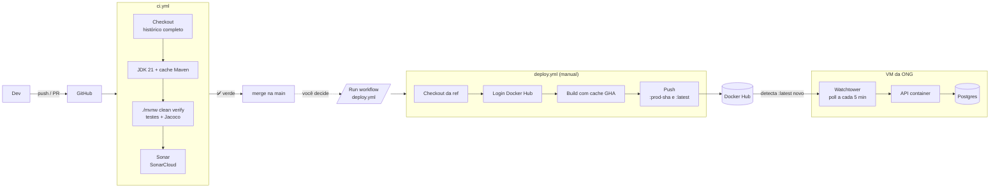
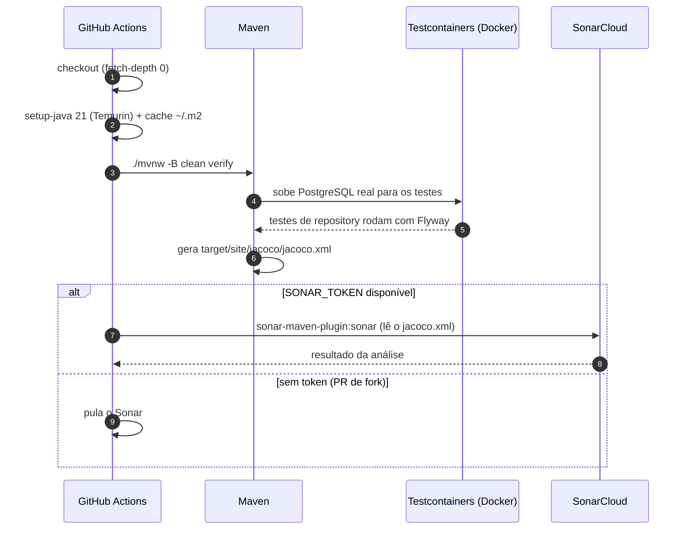
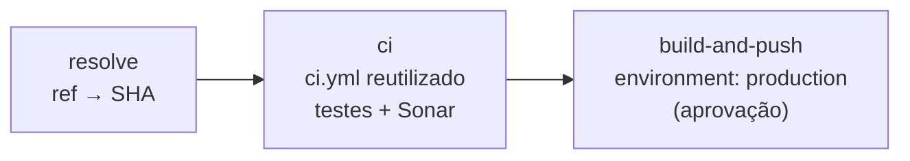
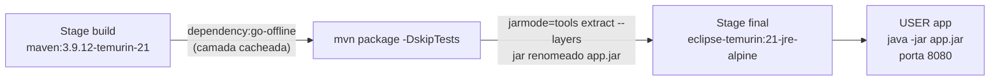

# Pipeline de CI/CD

Dois workflows no GitHub Actions, com responsabilidades separadas:

| Workflow                                          | Gatilho                                      | O que faz                                          |
|---------------------------------------------------|----------------------------------------------|----------------------------------------------------|
| [`ci.yml`](../../.github/workflows/ci.yml)        | push na `main`, PR, manual                   | Build, testes e análise no SonarCloud              |
| [`deploy.yml`](../../.github/workflows/deploy.yml)| **somente manual** (`workflow_dispatch`)     | Gera a imagem Docker e publica no Docker Hub       |

A **VM não é acessada pelo GitHub**. Quem atualiza o servidor é o **Watchtower**, rodando na própria VM, que
observa o Docker Hub e puxa a imagem nova. Detalhes em [`infraestrutura-deploy.md`](infraestrutura-deploy.md).

## Visão ponta a ponta

## `ci.yml` em detalhe

Por que cada escolha:

- **`fetch-depth: 0`** — o Sonar precisa do histórico para atribuir código novo × antigo.
- **`./mvnw`** — usa a versão do Maven fixada no repositório (`.mvn/`), igual para todo mundo.
- **Testcontainers** — os testes de banco usam PostgreSQL real, **sem H2** ([ADR 007](../adr/007-testcontainers-postgres.md)).
  O `ubuntu-latest` já traz Docker, então não há configuração extra.
- **Sonar condicional** — PRs vindos de fork não recebem secrets; sem a condição o job falharia.
- **`concurrency` com `cancel-in-progress`** — um push novo cancela a execução anterior da mesma ref,
  economizando minutos.

## `deploy.yml` em detalhe

Disparo: **Actions → Deploy - Projeto Resgate API → Run workflow**. O campo `ref` (padrão `main`) permite
escolher outra branch, tag ou SHA.

O deploy tem **três jobs encadeados**:

| Job              | O que faz                                                                                                   |
|------------------|-------------------------------------------------------------------------------------------------------------|
| `resolve`        | Faz o checkout da `ref` e grava o **SHA exato** (`git rev-parse HEAD`) e a tag `prod-<12 primeiros do SHA>`. O `ref` digitado entra por variável de ambiente, nunca interpolado no script (evita injeção de comando) |
| `ci`             | Chama o `ci.yml` como workflow reutilizável (`workflow_call`) **nesse SHA**: `mvnw clean verify` e Sonar. **Sempre roda** |
| `build-and-push` | Só roda se o `ci` passou (`needs: [resolve, ci]`). Usa `environment: production`, então a **aprovação manual só é pedida para um commit que já passou nos testes** |

Etapas do `build-and-push`:

| Etapa                  | Detalhe                                                                                        |
|------------------------|------------------------------------------------------------------------------------------------|
| Checkout               | No SHA resolvido (o mesmo que o CI validou).                                                   |
| Login                  | `DOCKERHUB_USERNAME` + `DOCKERHUB_TOKEN` (token de acesso, não a senha).                       |
| Build                  | Usa o `Dockerfile` (multi-stage, ver abaixo) com cache `type=gha`.                             |
| Push                   | Duas tags: **`:prod-<sha>`** (imutável, serve de rollback) e **`:latest`** (o que o Watchtower observa). |
| Rastreabilidade        | Labels OCI `org.opencontainers.image.revision` e `version`: `docker inspect` mostra de qual commit saiu a imagem. |
| Limpeza                | Apaga do Docker Hub as tags `prod-` antigas e mantém só a **do deploy atual e uma anterior** (mais o `:latest`). Ver abaixo. |

### Limpeza das tags no Docker Hub

O plano gratuito do Docker Hub tem armazenamento limitado (2 GB no repositório privado). Para não acumular, o último
passo do `build-and-push` apaga as tags `prod-` antigas:

- **Mantém:** `:latest`, a tag `prod-` do deploy que acabou de rodar e **a mais recente anterior a ela** (para rollback
  imediato). A quantidade de anteriores é a variável `KEEP_PREVIOUS` do passo (hoje `1`).
- **Apaga:** as demais tags `prod-`, da mais antiga para a mais nova. Tags com outro nome nunca são tocadas.
- **Como:** autentica em `POST https://hub.docker.com/v2/auth/token`, lista as tags e apaga cada uma com
  `DELETE /v2/namespaces/{namespace}/repositories/{repositorio}/tags/{tag}`. Esse `DELETE` **não está na referência
  oficial** da API do Docker Hub (é o que as ferramentas da comunidade usam); se a Docker mudar, o passo para de apagar.
- **Nunca derruba o deploy:** qualquer falha (autenticação, permissão, API) vira um **aviso** amarelo no resumo da
  execução; a imagem nova já foi publicada antes da limpeza.
- **Permissão:** o `DOCKERHUB_TOKEN` precisa ser um access token com **Read, Write, Delete**. Com Read & Write o push
  funciona, mas a limpeza só gera avisos de HTTP 403.

> Antes, a tag usava o `GITHUB_SHA`, que é o commit do workflow e não o da `ref` escolhida. Isso foi corrigido:
> agora a tag, o CI e o build usam o **mesmo SHA**.

### Para que serve o `workflow_call` do `ci.yml`

O `ci.yml` reage a `push`, `pull_request`, manual **e** `workflow_call`. Com o `workflow_call`, o `deploy.yml` o
chama como uma função, passando `inputs.ref` com o SHA a validar. No `push` e no PR o `inputs.ref` é vazio e o
checkout usa o commit do próprio evento. Sem isso, seria possível publicar uma imagem de um commit sem teste.

### O `Dockerfile`

- **Dependências antes do código:** o `pom.xml` é copiado e as dependências baixadas antes do `src`, com cache do
  `.m2`, então mudar só o código reaproveita a camada de dependências.
- **Jar em camadas:** dependências, loader, snapshots e aplicação em camadas separadas. No deploy normalmente só a
  camada de código (centenas de kB) é enviada e baixada, não a imagem inteira.
- **Só JRE e usuário sem privilégios:** a imagem final tem apenas o JRE e roda como o usuário `app` (uid 100),
  não como root. Tamanho da imagem: cerca de 285 MB.
- **Nome fixo `app.jar`:** mudar a versão no `pom.xml` não quebra mais o `ENTRYPOINT`.
- **Memória:** `JAVA_TOOL_OPTIONS="-XX:MaxRAMPercentage=70 -XX:+ExitOnOutOfMemoryError"`. Sem memória, o processo
  morre e o Docker reinicia. Em produção o compose usa `-XX:MaxRAMPercentage=60`.
- **`HEALTHCHECK`:** consulta `/actuator/health/liveness` (início de 90 s para o Flyway e o Spring subirem).
- **Desligamento gracioso:** `server.shutdown: graceful`, com até 25 s por fase. O compose dá `stop_grace_period: 40s`.
- **`.dockerignore`:** mantém `target/`, `.git`, `.env`, docs e testes fora do contexto de build.

Testado com o Spring Boot 4.1.2: build, subida a partir de banco vazio (18 migrations), container `healthy`,
processo como `app` e desligamento gracioso.

## Configuração necessária no GitHub

### Secrets (`Settings → Secrets and variables → Actions`)

| Secret               | Usado em    | Para quê                                                       |
|----------------------|-------------|----------------------------------------------------------------|
| `SONAR_TOKEN`        | `ci.yml`    | Token do SonarCloud                                            |
| `DOCKERHUB_USERNAME` | `deploy.yml`| Usuário do Docker Hub                                          |
| `DOCKERHUB_TOKEN`    | `deploy.yml`| **Access token** do Docker Hub com permissão **Read, Write, Delete** (o *delete* é usado pela limpeza de tags antigas) |

> Prefira guardar os dois do Docker Hub no **environment `production`** em vez do nível do repositório.

### Variables

| Variable             | Exemplo                       | Para quê                                 |
|----------------------|-------------------------------|------------------------------------------|
| `DOCKER_IMAGE_REPO`  | `seuusuario/projetoresgate-api` | Nome da imagem no Docker Hub           |
| `SONAR_PROJECT_KEY`  | `org_projetoresgate-api`      | Chave do projeto no SonarCloud           |
| `SONAR_ORGANIZATION` | `org`                         | Organização no SonarCloud                |

Os segredos da **aplicação** (banco, JWT, SMTP) **não** ficam no GitHub: ficam só no `.env` da VM.

> **Sonar falhando com `You must define the following mandatory properties: sonar.projectKey, sonar.organization`:**
> as variáveis `SONAR_PROJECT_KEY` e `SONAR_ORGANIZATION` não foram cadastradas (a aba **Variables**, não Secrets).
> O passo do Sonar roda sempre que o `SONAR_TOKEN` existe e usa essas duas variáveis.

## Segurança do pipeline

| Medida                                                             | Por quê                                                                                     |
|--------------------------------------------------------------------|---------------------------------------------------------------------------------------------|
| GitHub **não tem** credenciais da VM                               | Comprometer o repositório não dá acesso ao servidor nem ao banco.                           |
| Deploy só manual                                                   | Nada vai para produção sem uma pessoa decidir.                                              |
| Environment `production` com **Required reviewers**                | Um segundo olhar (ou o seu clique) antes de publicar. Configure em `Settings → Environments`. |
| Environment restrito à branch `main` (**Deployment branches**)     | Impede publicar e ler secrets a partir de uma branch arbitrária.                            |
| Proteção da `main` (PR obrigatório + CI verde)                     | Só código revisado e testado chega ao que é publicado por padrão.                           |
| Token do Docker Hub com escopo mínimo                              | Vazamento não expõe a conta inteira.                                                        |
| Nunca usar `pull_request_target` com secrets                       | Executaria código de PR de fork com acesso aos secrets.                                     |

## Dependabot

Atualizações automáticas de dependências (Maven, GitHub Actions, Docker e Compose) via PRs semanais: ver [`dependabot.md`](dependabot.md).

## Como fazer um deploy

1. **Actions → Deploy → Run workflow** (deixe `ref = main`). O CI roda sozinho dentro do deploy.
2. Se o CI passar, aprove o ambiente `production` quando o GitHub pedir.
3. Aguarde o job terminar (≈ 3–6 min).
4. Aguarde até **5 minutos** (intervalo do Watchtower) e valide — ver [`runbook.md`](runbook.md#validar-um-deploy).

## Como fazer rollback

A VM roda `:latest`. Para voltar à versão anterior, aponte o compose para a tag `prod-<sha>` anterior —
passo a passo em [`runbook.md`](runbook.md#rollback). Como a limpeza mantém **só uma** tag anterior, o rollback
automático alcança apenas o deploy imediatamente anterior; para voltar mais, gere a imagem de novo rodando o
`deploy.yml` com a `ref` (commit ou tag do git) desejada.

## Actions fixadas por SHA

Todas as actions de terceiros e do GitHub são referenciadas pelo **SHA completo do commit**, com a versão no
comentário (`uses: docker/login-action@<sha> # v3.7.0`). Uma tag como `v3` pode ser movida para outro código;
o SHA não. O Dependabot (`github-actions`) atualiza o SHA e o comentário juntos. Para trocar uma versão à mão,
pegue o SHA da tag com `git ls-remote --tags https://github.com/<dono>/<action>.git` (use a linha `^{}` quando
existir, que é o commit da tag anotada).

## Evoluções possíveis

| Ideia                                                  | Ganho                                            |
|--------------------------------------------------------|--------------------------------------------------|
| Quality Gate do Sonar bloqueando o merge               | Impede regressão de qualidade/cobertura          |
| Notificação (e-mail/Discord) ao fim do deploy          | Feedback — o job termina antes da VM atualizar   |
