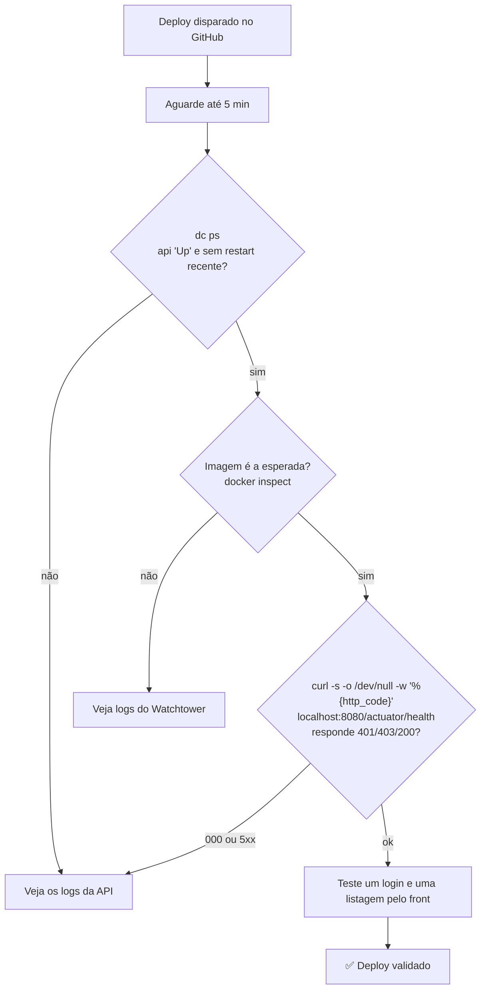

# Runbook de operação

Guia de bolso para operar a API em produção: validar deploy, ver logs, diagnosticar problema, voltar versão.
Todos os comandos assumem que você está **na VM**, como usuário `deploy`, em `~/projetoresgate`.

```bash
alias dc='docker compose -f docker-compose.prod.yml'   # facilita tudo abaixo
```

## Comandos do dia a dia

| Quero…                           | Comando                                                          |
|----------------------------------|------------------------------------------------------------------|
| Ver o que está rodando           | `dc ps`                                                          |
| Logs da API (ao vivo)            | `dc logs -f --tail 200 api`                                      |
| Logs do Watchtower               | `dc logs --tail 100 watchtower`                                  |
| Reiniciar só a API               | `dc restart api`                                                 |
| Ver qual imagem a API usa        | `docker inspect -f '{{.Config.Image}} {{.Image}}' projetoresgate_api` |
| Ver variáveis da API (sem segredos) | `docker exec projetoresgate_api env \| grep -v 'PASSWORD\|SECRET'` |
| Abrir `psql` no banco            | `docker exec -it projetoresgate_db psql -U "$DB_USERNAME" projetoresgatedb` |
| Uso de CPU/memória               | `docker stats --no-stream`                                       |
| Espaço em disco                  | `df -h` e `docker system df`                                     |

## Validar um deploy

Depois de rodar o `deploy.yml`, o Watchtower leva **até 5 minutos** para agir.



Checagem rápida:

```bash
dc ps
docker inspect -f '{{.Config.Image}}' projetoresgate_api
curl -s -o /dev/null -w '%{http_code}\n' http://localhost:8080/actuator/health
```

> `/actuator/health` **exige autenticação** na configuração atual, então `401` ou `403` significa
> *"a aplicação está de pé"*. `000` (sem conexão) ou `5xx` indicam problema.

## Rollback

A VM roda a tag `:latest`. Para voltar a uma versão específica, **fixe uma tag `prod-<sha>`** anterior.

1. Descubra a tag boa: Docker Hub → tags do repositório, ou `Actions` → execução do `deploy.yml` daquela versão
   (`prod-` + 12 primeiros caracteres do commit).
2. **Pare o Watchtower** para ele não "consertar" de volta para `:latest`:
   ```bash
   dc stop watchtower
   ```
3. Edite `docker-compose.prod.yml`: troque `image: ...:latest` por `image: ...:prod-<sha>` no serviço `api`.
4. Aplique:
   ```bash
   dc pull api && dc up -d api
   ```
5. Confirme com [Validar um deploy](#validar-um-deploy).
6. Corrija o problema no código, gere um deploy novo, **volte o compose para `:latest`** e religue o Watchtower:
   ```bash
   dc up -d        # sobe de novo o watchtower e a api em :latest
   ```

> ⚠️ **Migrations não voltam sozinhas.** Se a versão ruim aplicou uma migration, voltar a imagem não desfaz
> o schema. Migrations são sempre *forward-only* ([ADR 003](../adr/003-gerenciamento-banco-dados.md)); se
> precisar reverter dados, restaure o backup ([infraestrutura](infraestrutura-deploy.md#backup)).

## Diagnóstico por sintoma

| Sintoma                                            | Causa provável                                              | O que fazer                                                       |
|----------------------------------------------------|-------------------------------------------------------------|-------------------------------------------------------------------|
| API em loop de restart                             | Variável faltando, migration quebrada, banco inacessível    | `dc logs --tail 100 api` — a causa está nas últimas linhas        |
| `Could not resolve placeholder 'CORS-ALLOWED-ORIGINS'` | Variável com hífen não chegou ao container              | Ver [aviso](infraestrutura-deploy.md#variáveis-de-ambiente-env-na-vm); renomear no properties |
| `FlywayException` / `Validate failed`              | Migration commitada foi alterada, ou schema divergente      | **Nunca edite migration commitada.** Crie a próxima. ([ADR 003](../adr/003-gerenciamento-banco-dados.md)) |
| `Connection refused` ao banco                      | `db` ainda iniciando ou parado                              | `dc ps`; a API aguarda o healthcheck do `db`                      |
| Login funciona no Swagger mas **não no navegador** | Cookie `Secure` sem HTTPS, ou CORS/SameSite                 | Servir por HTTPS; conferir `CORS-ALLOWED-ORIGINS` e `API_COOKIE_*` |
| `401` em tudo após o deploy                        | `API_SECURITY_TOKEN_SECRET` mudou                           | Esperado: sessões antigas caem. Usuários fazem login de novo.     |
| `429 Too Many Requests`                            | Limite de requisições por IP (login/senha 5/min; público 20/min; geral 300/min) | Veja o `Retry-After` da resposta. Se **todos** os usuários recebem 429 ao mesmo tempo, há proxy na frente e falta `API_RATE_LIMIT_TRUSTED_PROXIES=1` |
| Usuário diz que "não chegou o e-mail" de reset/confirmação | Limite de **3 e-mails/hora** por destinatário (ignora em silêncio) | Aguarde 1 hora ou reinicie a API (zera os baldes). Confira também `API_RATE_LIMIT_EMAIL_*` |
| E-mail de reset/confirmação não chega              | Credencial Gmail/senha de app, ou link com `localhost`      | `dc logs api \| grep -i mail` |
| Backup gerado mas não chega ao Google Drive       | `rclone` sem configurar na VM, ou token expirado/revogado    | Veja o erro em `~/backups/backup.log`; refaça o [rclone config](infraestrutura-deploy.md#enviar-o-backup-para-o-google-drive-rclone) ou `rclone config reconnect remoto:` |
| Atualização não aconteceu                          | Watchtower parado, imagem privada sem credencial, tag errada| `dc logs watchtower`; confira `docker login` / `REPO_USER`        |
| Disco cheio                                        | Imagens antigas ou logs                                     | `docker system prune -af` (cuidado: remove imagens não usadas); `WATCHTOWER_CLEANUP` já ajuda |
| Banco lento / VM sem memória                       | JVM + Postgres competindo                                   | `docker stats`; ajuste `MaxRAMPercentage` e `shared_buffers`      |

## Criar o primeiro administrador

Em produção `POST /user` **não é público** (`API_USER_REGISTRATION_PUBLIC=false`), então o primeiro usuário é
criado direto no banco. Na VM, em `~/projetoresgate`:

```bash
DB_USERNAME=$(grep '^DB_USERNAME=' .env | cut -d= -f2-)
read -rsp 'E-mail do admin: ' ADMIN_EMAIL; echo
read -rsp 'Senha do admin: ' ADMIN_PASS; echo        # `read -s` evita que apareça no histórico

# gera o hash BCrypt (o Spring aceita o prefixo $2a)
HASH=$(docker run --rm httpd:2.4-alpine htpasswd -nbBC 10 "" "$ADMIN_PASS" | tr -d ':\n' | sed 's/^\$2y/$2a/')

docker exec -i projetoresgate_db psql -U "$DB_USERNAME" projetoresgatedb <<SQL
WITH u AS (
  INSERT INTO users (id, email, password, name, nickname, token_version, date_created, date_updated)
  VALUES (gen_random_uuid(), '$ADMIN_EMAIL', '$HASH', 'Administrador', 'admin', 0, now(), now())
  RETURNING id)
INSERT INTO user_roles (user_id, role) SELECT id, 'ADMIN' FROM u;
SQL
unset ADMIN_PASS HASH
```

Depois entre pelo front/Swagger e **crie os demais usuários logado** (`POST /user` com o token do admin).
A senha deve ter **6 ou mais caracteres**. Se a flag estiver ligada por engano em produção, o `POST /user`
volta a aceitar chamadas sem login: confira com
`docker exec projetoresgate_api env | grep API_USER_REGISTRATION_PUBLIC` (deve estar vazio ou `false`).

## Rotinas de manutenção

| Frequência | Tarefa                                                                                   |
|------------|------------------------------------------------------------------------------------------|
| Diária     | Backup automático ([cron](infraestrutura-deploy.md#backup), 1 vez por dia, às 3h) — confira em `~/backups/backup.log` que o arquivo apareceu |
| Semanal    | `dc ps` e olhar `docker stats`/`df -h` (sinal precoce de disco/memória)                  |
| Mensal     | `sudo apt update && sudo apt upgrade` (e reiniciar se pedir kernel novo)                 |
| Trimestral | **Testar restauração do backup** num ambiente local                                      |
| Anual      | Rotacionar `API_SECURITY_TOKEN_SECRET`, senha do banco e o token do Docker Hub           |

## Contatos e acessos

Preencha e mantenha atualizado (fora do git, em gerenciador de senhas):

| Item                         | Onde está                         |
|------------------------------|-----------------------------------|
| IP/porta/usuário da VM       | _gerenciador de senhas_           |
| Conta do Docker Hub          | _gerenciador de senhas_           |
| Conta do SonarCloud          | _gerenciador de senhas_           |
| Conta Gmail do SMTP          | _gerenciador de senhas_           |
| Contato da empresa dona da VM| _preencher_                       |
