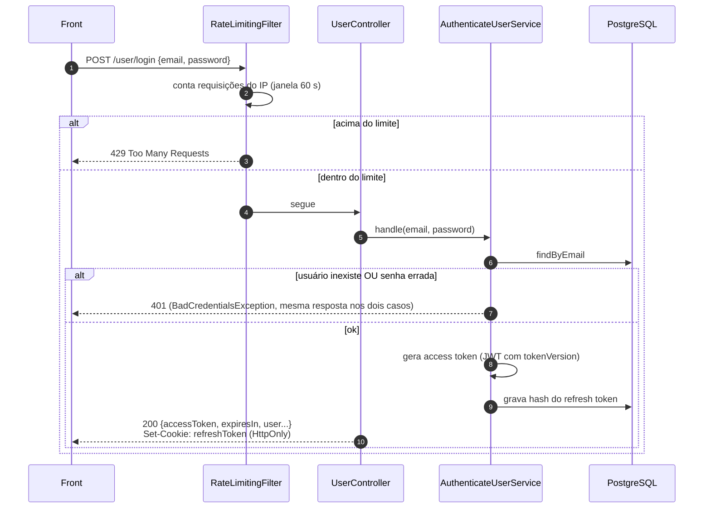
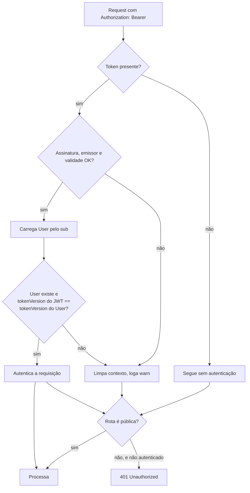
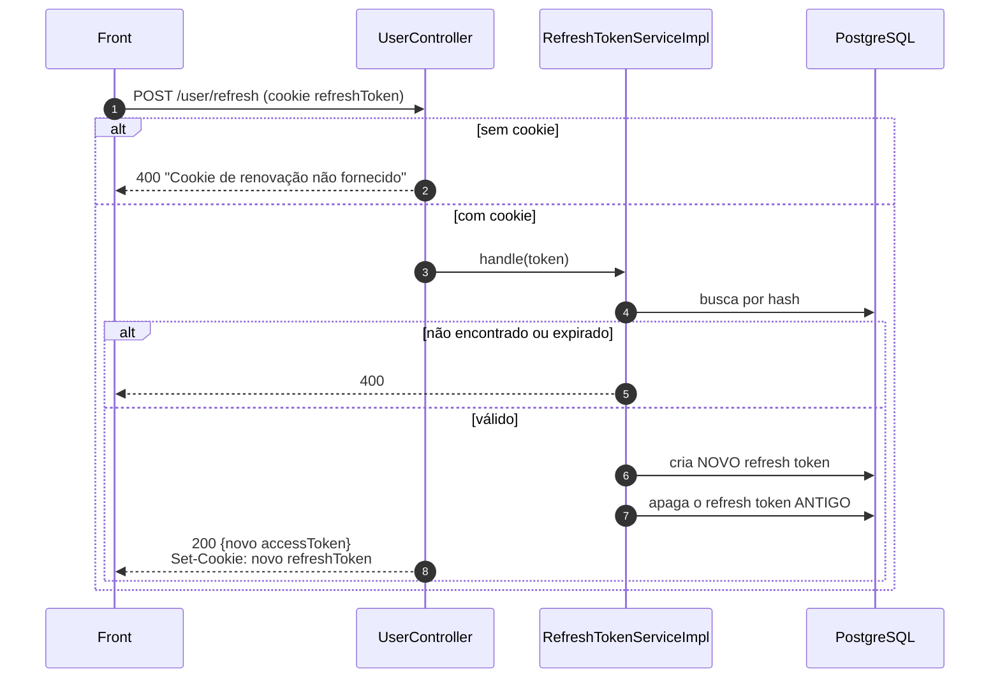
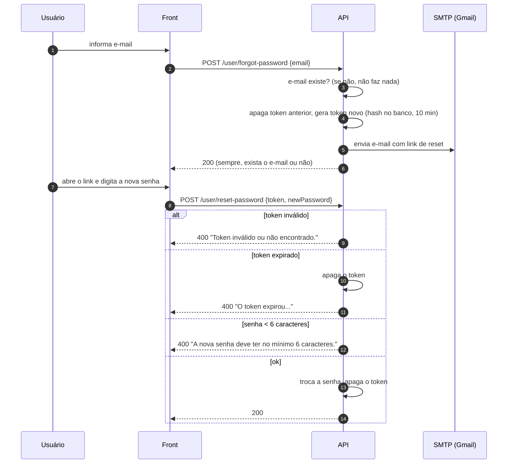
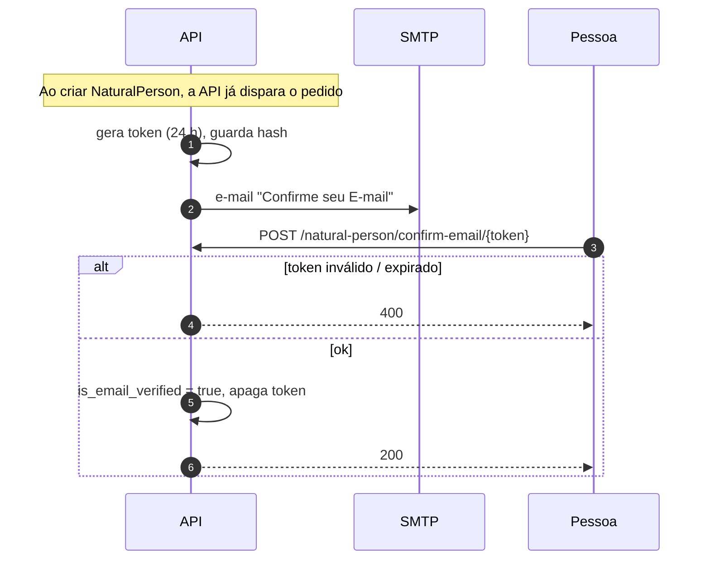

# Autenticação e sessão

Como alguém entra, permanece logado e sai do sistema. Decisão de arquitetura em
[ADR 006](../adr/006-seguranca-autenticacao.md); este documento descreve o **comportamento** e os fluxos.

## Resumo

| Item                    | Valor                                                                                             |
|-------------------------|---------------------------------------------------------------------------------------------------|
| Esquema                 | JWT stateless no header `Authorization: Bearer <accessToken>`                                     |
| Access token            | Assinado HS256 (`api.security.token.secret`), emissor `projetoresgate_api`, **15 min** (900 s)    |
| Refresh token           | Valor aleatório, guardado como **hash** no banco, entregue em **cookie `refreshToken`**, **7 dias**|
| Cookie                  | `HttpOnly`, `Secure` e `SameSite=Strict` em produção (`api.cookie.*`)                             |
| Senha                   | BCrypt                                                                                            |
| Rate limit              | `/user/login` e `/user/refresh`: **5 req / 60 s por IP** em produção (20 em dev)                  |
| Autorização por perfil  | **Não existe.** Só há o papel `ADMIN` e nada o consulta (ver [RFC 0001](../rfc/0001-autorizacao-por-role.md)) |

Os tempos são configuráveis por variável de ambiente: `API_SECURITY_ACCESS_TOKEN_DURATION`,
`API_SECURITY_REFRESH_TOKEN_DURATION`, `API_RATE_LIMIT_MAX_REQUESTS`, `API_RATE_LIMIT_WINDOW_SECONDS`.

## Rotas públicas

Tudo exige token, **exceto**:

| Rota                                              | Para quê                              |
|---------------------------------------------------|---------------------------------------|
| `POST /user`                                      | Criar usuário — **só público quando `api.user-registration.public=true` (dev)**; em produção exige login |
| `POST /user/login`, `/user/refresh`               | Entrar / renovar                      |
| `POST /user/forgot-password`, `/user/reset-password` | Recuperar senha                    |
| `POST /natural-person`                            | Cadastro de pessoa física (**ver aviso**) |
| `POST /natural-person/request-email-confirmation`, `/natural-person/confirm-email/{token}` | Confirmar e-mail |
| `/swagger-ui/**`, `/v3/api-docs/**`               | Documentação                          |

> **`POST /user` e produção.** Todo usuário criado nasce `ADMIN`, então a rota **não pode ser pública em
> produção**. Ela só é liberada sem login quando `api.user-registration.public=true`: o perfil `dev` liga,
> e a produção usa `API_USER_REGISTRATION_PUBLIC` (padrão **`false`**). Desligada, `POST /user` devolve
> **401** sem login e continua funcionando para quem está autenticado. O primeiro administrador em produção
> é criado por SQL: ver [runbook](../operacao/runbook.md#criar-o-primeiro-administrador).
>
> ⚠️ `POST /natural-person` segue público e dispara e-mail.

## Fluxo: login

Usuário inexistente e senha errada retornam a **mesma** resposta, para não revelar quais e-mails existem.

## Fluxo: requisição autenticada

O filtro **nunca responde erro sozinho**: se o token é inválido, apenas deixa a requisição anônima, e quem
barra é a regra `anyRequest().authenticated()`.

## Fluxo: renovar sessão (refresh com rotação)

**Rotação:** cada refresh invalida o anterior. Reusar um refresh token antigo falha.

## Fluxo: logout

| Endpoint            | Efeito                                                                                                       |
|---------------------|--------------------------------------------------------------------------------------------------------------|
| `POST /user/logout` | Apaga **este** refresh token e limpa o cookie. O access token continua válido até expirar (≤ 15 min).        |
| `POST /user/logout-all` | Apaga **todos** os refresh tokens do usuário **e incrementa `tokenVersion`** → todos os access tokens já emitidos passam a ser rejeitados na hora. Exige estar autenticado. |

`tokenVersion` é o mecanismo de revogação imediata: o JWT carrega a versão; se não bate com a do banco,
o filtro descarta o token.

## Fluxo: esqueci minha senha

- A resposta é **sempre 200** em `forgot-password`, para não revelar se o e-mail existe.
- O token vale **10 minutos** e é de uso único.
- ⚠️ Trocar a senha **não** invalida sessões existentes (não incrementa `tokenVersion`).
- O link do e-mail é `<FRONTEND_URL>/reset-password?token=...` (propriedade `app.frontend-url`; a barra final é ignorada).

## Fluxo: confirmação de e-mail (pessoa física)

- Pode-se pedir novo e-mail em `POST /natural-person/request-email-confirmation`. Se o e-mail não existe
  ou **já está verificado**, nada acontece (silencioso).
- O token vale **24 horas**.
- O link do e-mail é `<FRONTEND_URL>/confirm-email/<token>` (mesma propriedade `app.frontend-url` do reset de senha).
- O e-mail verificado é só informativo hoje: nada no sistema bloqueia quem não confirmou.

## Limpeza de tokens expirados

`RefreshTokenCleanupTask` roda a cada hora (`api.security.refresh-token.cleanup.rate`, 3 600 000 ms) e apaga
refresh tokens vencidos. Pode ser desligado com `API_SECURITY_REFRESH_TOKEN_CLEANUP_ENABLED=false`.

## Variáveis de ambiente relacionadas

| Variável                                   | Padrão   | Observação                                          |
|--------------------------------------------|----------|-----------------------------------------------------|
| `API_SECURITY_TOKEN_SECRET`                | —        | **Obrigatória.** Troque ao suspeitar de vazamento (derruba todas as sessões). |
| `API_SECURITY_ACCESS_TOKEN_DURATION`       | `900`    | Segundos.                                           |
| `API_SECURITY_REFRESH_TOKEN_DURATION`      | `604800` | Segundos. Também é o `Max-Age` do cookie.           |
| `API_COOKIE_SECURE`                        | `true`   | Exige HTTPS. Em HTTP puro o navegador ignora o cookie. |
| `API_COOKIE_SAME_SITE`                     | `Strict` | Se front e API ficarem em domínios diferentes, será preciso `None` (+ `Secure`). |
| `FRONTEND_URL`                             | —        | **Obrigatória em produção.** URL base do front, usada nos links dos e-mails (ex.: `https://app.exemplo.org`). Em dev é `http://localhost:5173`. |
| `API_USER_REGISTRATION_PUBLIC`             | `false`  | `true` libera `POST /user` **sem login**. Nunca ligar em produção. |
| `CORS-ALLOWED-ORIGINS`                     | —        | Origem(ns) do front. Nome **com hífen** (ver [deploy](../operacao/infraestrutura-deploy.md)). |
