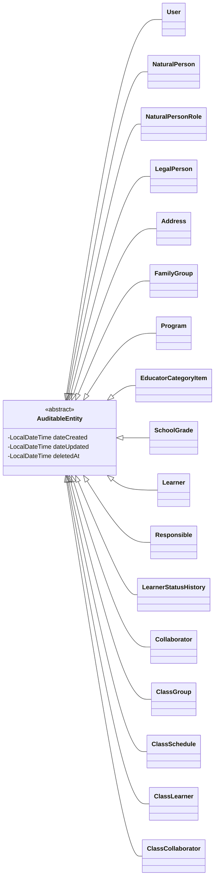
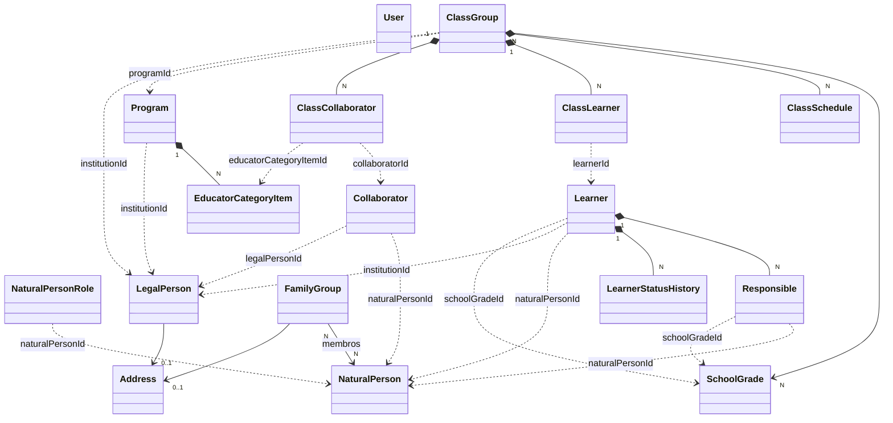
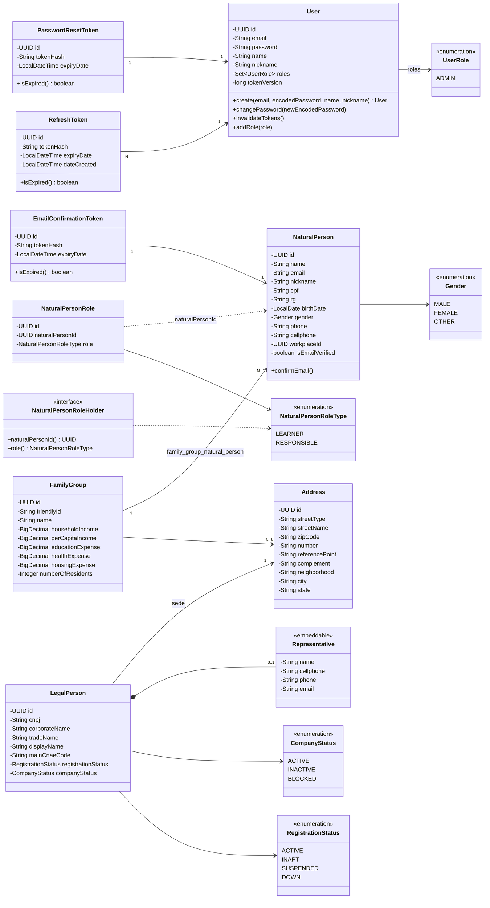
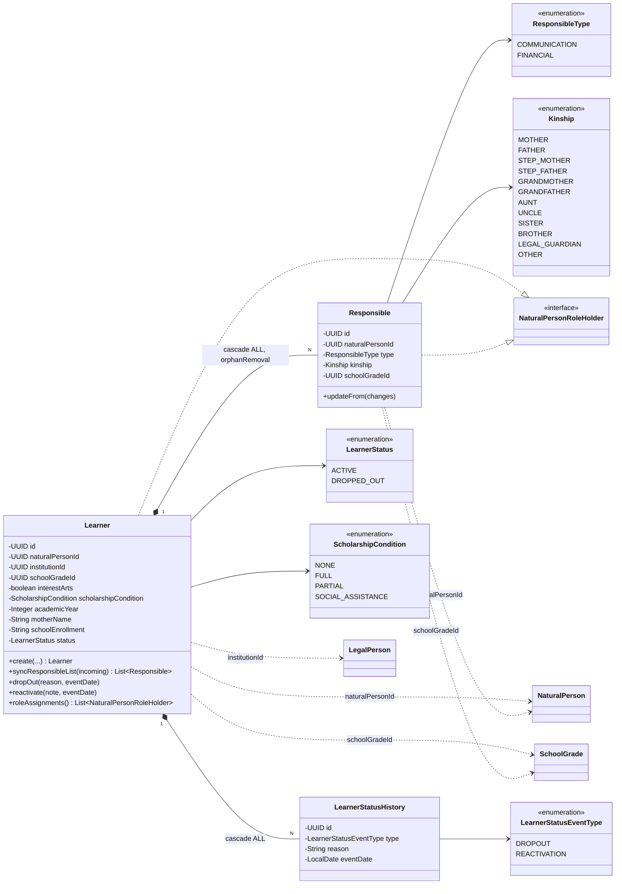
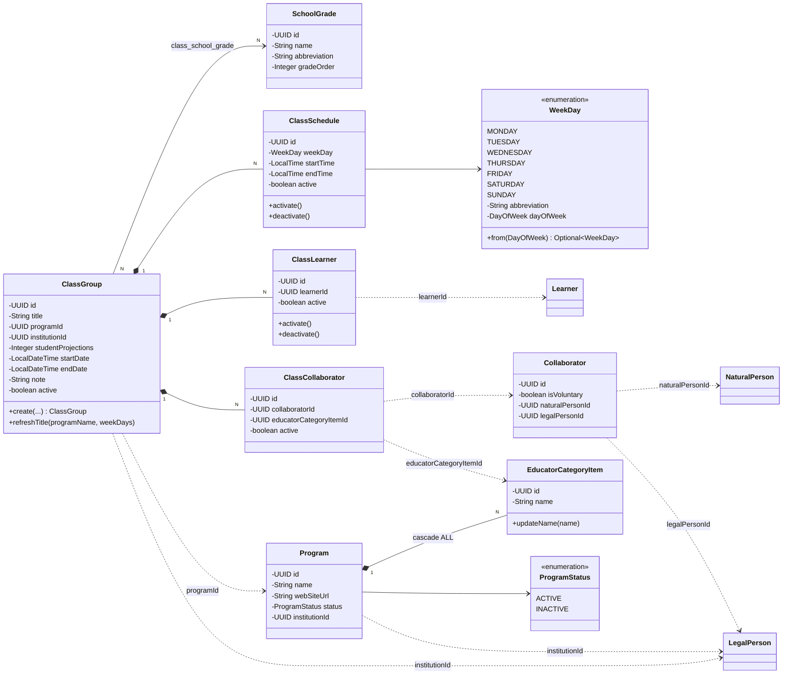

# Diagrama de classes (domínio)

Entidades do pacote `domain` de cada módulo. Para o desenho das **tabelas**, veja
[`modelo-de-dados.md`](modelo-de-dados.md); para a organização dos módulos,
[`mapa-de-modulos.md`](mapa-de-modulos.md).

## Como ler

| Notação                         | Significado                                                                                                                          |
|---------------------------------|--------------------------------------------------------------------------------------------------------------------------------------|
| Linha **sólida** (`-->`, `*--`) | **Associação JPA** de verdade (`@OneToMany`, `@ManyToOne`, `@ManyToMany`, `@OneToOne`)                                               |
| Linha **tracejada** (`..>`)     | **Referência por `UUID`**: a classe guarda só o id, sem `@ManyToOne`. A integridade vem da FK do banco e das validações nas services |
| `+tipo atributo`                | Atributo (privado na classe; getters omitidos)                                                                                       |
| `+metodo()`                     | Regra de negócio no domínio. `create`, `validate()` e `update()` existem em todas e foram omitidos, salvo quando carregam regra      |
| `<<enumeration>>`               | Enum                                                                                                                                 |

Todas as entidades (exceto os tokens) estendem `AuditableEntity` e usam **soft delete**
(`@SQLDelete` + `@SQLRestriction("deleted_at IS NULL")`):

`RefreshToken`, `PasswordResetToken` e `EmailConfirmationToken` **não** estendem `AuditableEntity` (não têm
soft delete: são apagados de verdade).

## 1. Visão geral

Só as classes e como se ligam (atributos nos diagramas seguintes).

## 2. Identidade

> `User` e `NaturalPerson` **não se relacionam**: `User` é quem acessa o sistema; `NaturalPerson` é quem é
> cadastrada (aluno, responsável, educador).
> `LegalPerson` exige `Address` (obrigatório); em `FamilyGroup` o endereço é opcional.
> `FamilyGroup.friendlyId` usa o prefixo constante `FAM-` seguido do número da sequence.
> `RefreshToken` e `PasswordResetToken` são mapeados com `@OneToOne` para `User`, mas na prática cada login cria
> **um refresh token novo** (a coluna `user_id` não é única), então um usuário pode ter vários.

## 3. Educando e responsáveis

Regras que moram aqui (`Learner`): o educando não é responsável de si mesmo, não há responsável repetido,
`dropOut` exige motivo e falha se já desistente, `reactivate` falha se já ativo.
Ao implementar `NaturalPersonRoleHolder`, `Learner` e `Responsible` alimentam a tabela de papéis
(`LEARNER` / `RESPONSIBLE`) via `LearnerRoleSynchronizer`.

## 4. Programas, séries, colaboradores e turmas

Regras que moram aqui:

- `ClassGroup`: o término é calculado (`startDate + duração em meses`; a duração **não** é guardada) e
  `refreshTitle` recompõe `Programa - Séries - Dias`.
- `ClassSchedule`: fim deve ser posterior ao início.
- `Collaborator`: `isVoluntary` e `legalPersonId` (empresa) são opcionais; a pessoa física é obrigatória.
- A categoria de um `ClassCollaborator` precisa pertencer ao **programa da turma**; essa checagem está na
  service (`findByIdAndProgramIdOrThrow`), não na entidade.
## Notas das últimas mudanças

- `ClassGroup.schoolGradeList` referencia `SchoolGradeRef`, uma entidade somente leitura (`@Immutable`) mapeada na
  mesma tabela `school_grade`, com o mesmo filtro de exclusão das demais entidades. Uma série usada por turma não
  pode ser excluída ([RN-GER-05](regras-implementadas.md#exclusão-e-cascatas)).
- `NaturalPerson.workplaceId` aponta para `LegalPerson` (local de trabalho), por id, sem associação JPA.
- `LearnerParticipationStatus` (`ACTIVE`, `NO_CLASS`, `DROPPED_OUT`) é um enum de resposta, **calculado** na
  listagem de educandos. O que é gravado no `Learner` continua sendo `LearnerStatus` (`ACTIVE`, `DROPPED_OUT`).
- `LearnerStatusHistory` (`DROPOUT` e `REACTIVATION`) é exposto por `GET /learner/{id}/status-history`.
