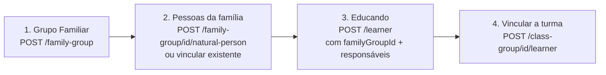
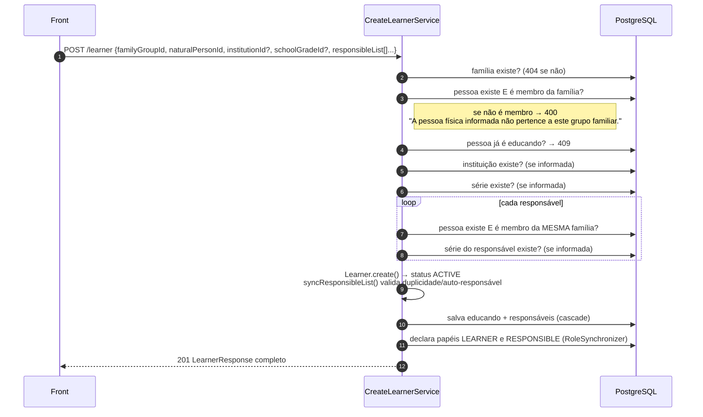
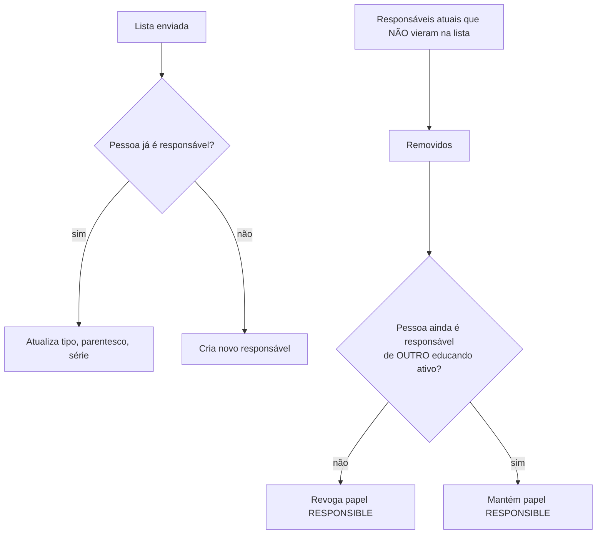
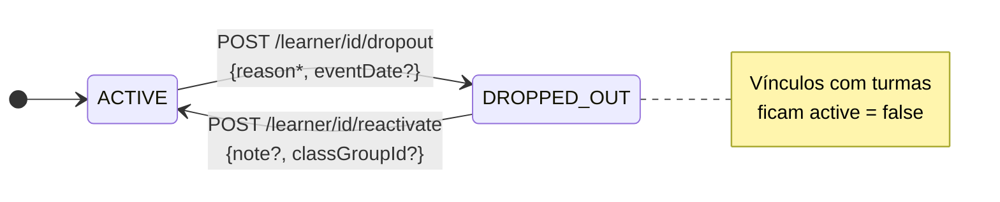

# Educandos, responsáveis e famílias

O caminho mais importante do produto: **cadastrar uma família, nela uma criança (educando) e quem responde
por ela (responsáveis)**. Este documento descreve a ordem das operações, as regras e o ciclo de vida
(desistência e reativação).

## Ordem de cadastro

Um educando **não pode ser criado do nada**. Ele depende de uma família e de pessoas já cadastradas:

| Passo | Endpoint                                                           | Observação                                                                 |
|-------|--------------------------------------------------------------------|----------------------------------------------------------------------------|
| 1     | `POST /family-group`                                               | Gera o ID amigável `FAM-<n>`. Nome da família é único.                     |
| 2a    | `POST /family-group/{id}/natural-person`                           | **Cria** uma pessoa física nova e já a vincula à família (dispara e-mail de confirmação). |
| 2b    | `POST /family-group/{id}/natural-person/{naturalPersonId}`         | Vincula uma pessoa **já existente**. Se já estiver vinculada → 409. Para achar a pessoa, o front usa `GET /natural-person/autocomplete?searchTerm=` (ver abaixo).        |
| 3     | `POST /learner`                                                    | Exige `familyGroupId`, `naturalPersonId` e lista de responsáveis.          |
| 4     | `POST /class-group/{classGroupId}/learner`                         | Ver [`fluxo-turmas.md`](fluxo-turmas.md).                                              |

**Buscar a pessoa a vincular:** `GET /natural-person/autocomplete?searchTerm=<texto>&limit=<n>` (padrão 10
resultados, ordenados por nome). O termo é comparado, com busca **parcial** (contém), contra:

| Campo     | Como compara                                                        |
|-----------|---------------------------------------------------------------------|
| Nome      | Sem diferenciar maiúsculas/minúsculas                               |
| Apelido   | Sem diferenciar maiúsculas/minúsculas                               |
| CPF       | Só os **dígitos** do termo (pontuação é ignorada)                   |
| RG        | Só **letras e números** do termo, sem diferenciar maiúsculas        |

Os critérios são combinados com **OU**: basta um bater. Sem termo, devolve as primeiras pessoas por nome.

Para montar a lista de responsáveis na tela, `GET /learner/eligible-responsibles?familyGroupId=...&excludeNaturalPersonId=...`
devolve as pessoas da família que **podem** ser responsáveis (a própria criança é excluída).

## Fluxo: criar educando

### Regras de validação (educando)

| Regra                                                                                       | Resposta |
|---------------------------------------------------------------------------------------------|----------|
| Pessoa física, status e `familyGroupId` são obrigatórios                                    | 400      |
| A pessoa e **todos** os responsáveis precisam pertencer ao grupo familiar informado          | 400      |
| Uma pessoa física só pode ser educando **uma vez** (entre os não excluídos)                  | 409      |
| O educando **não pode ser responsável de si mesmo**                                          | 400      |
| A mesma pessoa **não pode** ser responsável do mesmo educando duas vezes                     | 400      |
| Cada responsável exige **tipo** (`COMMUNICATION`/`FINANCIAL`) e **parentesco** (`Kinship`)   | 400      |
| Ano letivo entre 1900 e 2100; nome da mãe e matrícula escolar ≤ 255 caracteres               | 400      |
| No update, **não é possível trocar** a pessoa física do educando                             | 400      |

`interestArts` (interesse em artes) assume `false` quando não enviado.

## Atualização e sincronização de responsáveis

`PUT /learner/{id}` **substitui** a lista de responsáveis pela enviada (semântica de "estado desejado"):

Enviar lista vazia/nula remove **todos** os responsáveis.

## Papéis derivados (LEARNER / RESPONSIBLE)

`NaturalPersonRole` registra *que papéis* uma pessoa exerce, para a listagem de membros da família poder exibir "Educando",
"Responsável" sem consultar várias tabelas. É mantido pelo `LearnerRoleSynchronizer`:

| Evento                              | Efeito nos papéis                                                                                   |
|-------------------------------------|-----------------------------------------------------------------------------------------------------|
| Criar/atualizar educando            | Garante `LEARNER` para a criança e `RESPONSIBLE` para cada responsável (idempotente)                |
| Remover responsável no update       | Revoga `RESPONSIBLE` **só se** a pessoa não responde mais por nenhum educando                       |

Os papéis são **derivados**: nunca são editados diretamente pela API. Se ficarem inconsistentes, o
conserto é regravar o educando ou ajustar no banco.

## Desistência e reativação

O educando **não é excluído**: não existe `DELETE /learner/{id}`. O ciclo de vida é só desistência e reativação.

### Situação exibida na listagem (`status`)

`GET /learner` devolve em cada item o campo `status`, **calculado** (não é gravado) a partir do cadastro e das turmas:

| `status`      | Regra                                                                                                    |
|---------------|----------------------------------------------------------------------------------------------------------|
| `ACTIVE`      | Cadastro ativo **e** vínculo ativo em pelo menos uma turma **ativa e em andamento agora** (hoje entre início e fim) |
| `NO_CLASS`    | Cadastro ativo, mas sem turma em andamento: turma futura, encerrada, suspensa ou vínculo inativo         |
| `DROPPED_OUT` | Desistiu e não foi reativado, mesmo que ainda tenha vínculo com turma                                    |

O filtro `?status=` aceita os mesmos três valores. Quem aparece em duas turmas em andamento aparece **uma só vez**.
O status gravado no cadastro (`Learner.status`) continua tendo só `ACTIVE` e `DROPPED_OUT`.

### Desistir (`dropout`)

1. Falha com **409** se já estiver `DROPPED_OUT`.
2. Registra `LearnerStatusHistory(DROPOUT)` — o **motivo é obrigatório** (400 se vazio). O histórico é consultável em `GET /learner/{id}/status-history`.
3. A data do evento é a informada ou **hoje**.
4. Muda o status para `DROPPED_OUT`.
5. **Desativa todos os vínculos do educando com turmas** (`ClassLearner.active = false`) e devolve na
   resposta **quantos vínculos foram desativados** (`deactivatedClassLinks`).

Tudo numa só transação: se qualquer etapa falhar, nada é gravado.

### Reativar (`reactivate`)

`POST /learner/{id}/reactivate {note?, classGroupId?}`

| Situação do educando | `classGroupId` | Efeito                                                                                          |
|----------------------|----------------|-------------------------------------------------------------------------------------------------|
| `DROPPED_OUT`        | ausente        | Cadastro volta a `ACTIVE`, com `LearnerStatusHistory(REACTIVATION)` (data de **hoje**). **Nenhum vínculo é reativado** |
| `DROPPED_OUT`        | informado      | Cadastro volta a `ACTIVE` **e** o vínculo **só daquela turma** é criado ou ativado               |
| `ACTIVE`             | informado      | Só o vínculo daquela turma é criado ou ativado. **Sem erro e sem novo histórico**                |
| `ACTIVE`             | ausente        | **409** (o educando não está desistente)                                                        |

- Se já existe vínculo com a turma, mesmo inativo, ele é **reativado** (não se cria outro: há índice único por turma e educando). Vínculo já ativo não gera erro.
- Os vínculos das **outras** turmas continuam inativos.
- Turma inexistente ou excluída: **404**, e a reativação inteira é desfeita.
- Educando cuja **pessoa física foi excluída**: **404** ao vincular (a pessoa precisa existir).
- Tudo numa só transação.

### Histórico (`status-history`)

`GET /learner/{id}/status-history` lista os eventos do **mais recente para o mais antigo**:

| Campo          | Conteúdo                                                        |
|----------------|-----------------------------------------------------------------|
| `id`           | Id do evento                                                    |
| `type`         | `DROPOUT` ou `REACTIVATION`                                     |
| `reason`       | Motivo da desistência ou observação da reativação               |
| `eventDate`    | Data do evento (informada ou a de hoje)                         |
| `registeredAt` | Data e hora em que o registro foi feito                         |

Lista vazia se nunca houve evento; **404** se o educando não existir.

## Excluir

| Operação                       | Efeito                                                                                          |
|--------------------------------|-------------------------------------------------------------------------------------------------|
| `DELETE /family-group/{id}`    | Soft delete só do grupo. Pessoas e educandos **não** são afetados.                               |
| `DELETE .../natural-person/{id}` (da família) | Só **desvincula** a pessoa da família (409 se não estava vinculada). Não exclui a pessoa. |

Ver [tabela completa de cascatas](regras-implementadas.md#exclusão-e-cascatas).

## Grupo familiar: regras

| Regra                                                                  | Resposta |
|------------------------------------------------------------------------|----------|
| Nome obrigatório, ≤ 255 caracteres e **único**                         | 400      |
| Renda familiar, per capita e despesas (educação, saúde, moradia) **não podem ser negativas** | 400 |
| Número de moradores, quando informado, **≥ 1**                         | 400      |
| `friendlyId` segue `FAM-<n>`, gerado pela sequence — **não** é editável | —       |
| Endereço é opcional; se enviado, exige **CEP, cidade e estado**        | 400      |

Os valores monetários usam `BigDecimal` (15,2). O sistema **não calcula** a renda per capita: ela é
informada pelo usuário.
