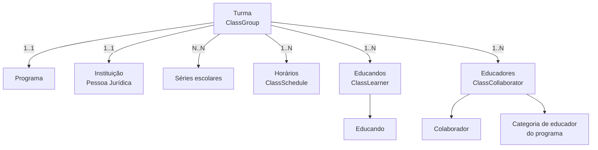
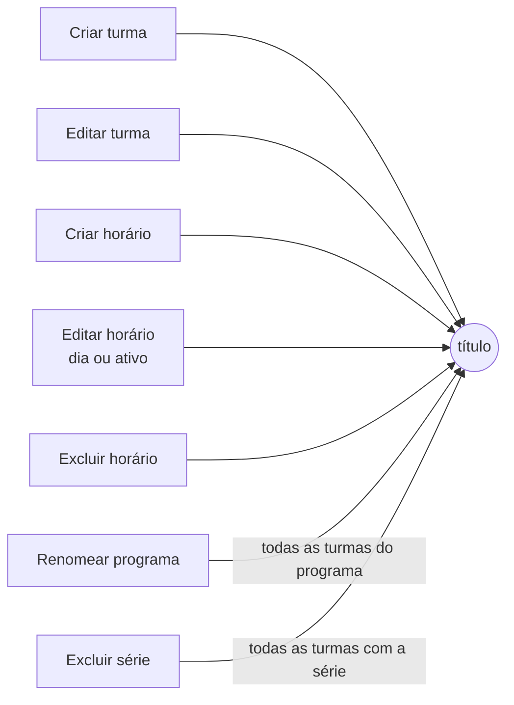

# Turmas, horários, educandos e educadores

A **turma** (`ClassGroup`) é a oferta concreta de um programa: *qual programa, em qual instituição, para
quais séries, em que período, em quais dias e horários, com quais educandos e educadores*.

## Estrutura



Os sub-recursos são endpoints aninhados na turma:

| Recurso    | Base                                      | Operações               |
|------------|-------------------------------------------|-------------------------|
| Turma      | `/class-group`                            | criar, editar, listar, buscar, excluir |
| Horários   | `/class-group/{classGroupId}/schedule`    | criar, editar, listar, excluir |
| Educandos  | `/class-group/{classGroupId}/learner`     | vincular, listar, remover (**sem edição**) |
| Educadores | `/class-group/{classGroupId}/collaborator`| vincular, editar, listar, remover |

## Regras da turma

| Regra                                                                                             | Resposta |
|---------------------------------------------------------------------------------------------------|----------|
| Programa e instituição são obrigatórios **e precisam existir**                                    | 404 (não existe) / 400 (ausente) |
| Previsão de alunos (`studentProjections`) obrigatória, **≥ 0**                                    | 400      |
| Data de início obrigatória                                                                        | 400      |
| **Data de término = início + duração em meses**: é calculada, não informada                       | —        |
| Término não pode ser anterior ao início                                                           | 400      |
| Observação ≤ 2000 caracteres                                                                      | 400      |
| Todas as séries informadas precisam existir (senão a operação inteira falha)                      | 400      |
| `active` controla se a turma está em andamento; é editável no `PUT`                               | —        |

### Edição (`PUT /class-group/{id}`)

É **parcial**: campos `null` mantêm o valor atual (programa, instituição, previsão, `active`). Exceções:

- `note` **sempre** é sobrescrita (enviar `null` apaga a observação);
- `schoolGradeIds` só muda as séries se for enviado (`null` mantém; lista vazia **remove todas**);
- mudar `startDate` ou `durationInMonths` **recalcula** `endDate`. Se só a duração mudar, usa-se o início atual.

## Título automático

O título da turma **não é digitado**: é gerado e mantido pelo sistema.

```
<Nome do programa> - <Séries abreviadas> - <Dias da semana>
```

Exemplo: `Reforço Escolar - 1º ano, 2º ano - Seg, Qua`

Regras de composição:

- **Séries:** ordenadas por `gradeOrder`; usa a **abreviação** da série (ou o nome, se não houver abreviação);
  sem repetições.
- **Dias:** só os horários **ativos**, sem repetição, na ordem Seg→Dom, com abreviação em português
  (`Seg, Ter, Qua, Qui, Sex, Sáb, Dom`).
- Partes vazias são omitidas (turma sem horários não tem a terceira parte).
- Limite de 255 caracteres; estourar lança "Não foi possível gerar o título da turma."

> A abreviação dos dias está no **backend** só para compor o título. A tradução dos dias na tela é
> responsabilidade do front (ver commit `431788d`). O endpoint devolve o enum (`MONDAY`…).

### Quando o título é recalculado



Renomear um programa ou excluir uma série reescreve o título de **todas** as turmas afetadas
(`RefreshClassGroupTitlesService`), em lote e na mesma transação.

## Horários

- Dia da semana, início e fim são obrigatórios; **fim deve ser depois do início** (400).
- Pode haver vários horários no mesmo dia.
- ⚠️ **Não há checagem de sobreposição** entre horários da mesma turma, nem conflito entre turmas.
- `PUT` aceita `active` para pausar um horário sem excluí-lo; horário inativo **sai do título**.

## Vincular educando

`POST /class-group/{classGroupId}/learner {learnerId}`

| Regra                                                          | Resposta |
|----------------------------------------------------------------|----------|
| Turma e educando precisam existir                              | 404      |
| A **pessoa física do educando precisa existir** (não excluída)  | 404      |
| O educando **não pode estar duas vezes** na mesma turma, mesmo com o vínculo **inativo** | 409 |
| ⚠️ **Não valida** o status do educando: dá para vincular um `DROPPED_OUT` | — |
| ⚠️ **Não valida** compatibilidade de série nem a **previsão de alunos** (é só uma projeção) | — |

A resposta já traz nome, CPF e **status** do educando, para a tela exibir "desistente".

Um educando pode estar em **várias turmas** ao mesmo tempo.

### Efeito da desistência

Ao registrar desistência, **todos os vínculos** do educando com turmas viram `active = false` numa query
única (`deactivateByLearnerId`). Os vínculos aparecem na turma como inativos, mas **não são removidos**.
Reativar o educando **sem** informar turma não reativa os vínculos. Para trazê-lo de volta a uma turma, use
`POST /learner/{id}/reactivate` com `classGroupId` (ver [educandos](fluxo-educandos.md#reativar-reactivate)):
é o caminho certo para vínculo **inativo**, porque o `POST` desta rota devolve 409 quando o vínculo já existe.

## Vincular educador

`POST /class-group/{classGroupId}/collaborator {collaboratorId, educatorCategoryItemId}`

| Regra                                                                                              | Resposta |
|----------------------------------------------------------------------------------------------------|----------|
| Turma e colaborador precisam existir                                                               | 404      |
| A **categoria de educador precisa pertencer ao programa da turma**                                 | 404      |
| O colaborador **não pode estar duas vezes** na mesma turma                                         | 409      |
| A **pessoa física do colaborador precisa existir** (não excluída)                                  | 404      |

A categoria é "o papel do educador **nesta turma**" (ex.: Professor, Auxiliar) e vem das categorias
cadastradas no **programa**. Na edição, trocar a categoria exige que a nova também seja do programa.

⚠️ Se o **programa da turma for trocado** (`PUT`), os educadores já vinculados **continuam** com a categoria
do programa antigo — não há revalidação.

## Excluir turma

`DELETE /class-group/{id}` faz soft delete em **cascata manual**, na mesma transação:

1. horários da turma;
2. educadores da turma;
3. educandos da turma;
4. limpa a associação com séries;
5. a própria turma.

O programa, a instituição, os educandos e os colaboradores em si **não** são afetados — só os vínculos.

## Listagem e busca

`GET /class-group` é paginado e filtra via `SpecificationBuilder` (ver
[ADR 009](../adr/009-busca-com-specification-builder.md)). O response resumido
(`ClassGroupSummaryResponse`) traz id, título, programa, instituição e `active`; o detalhe
(`GET /class-group/{id}`) acrescenta séries, previsão de alunos, datas de início/término, duração, observação
e data de criação. Educandos, educadores e horários **não** vêm embutidos: use os sub-recursos.
