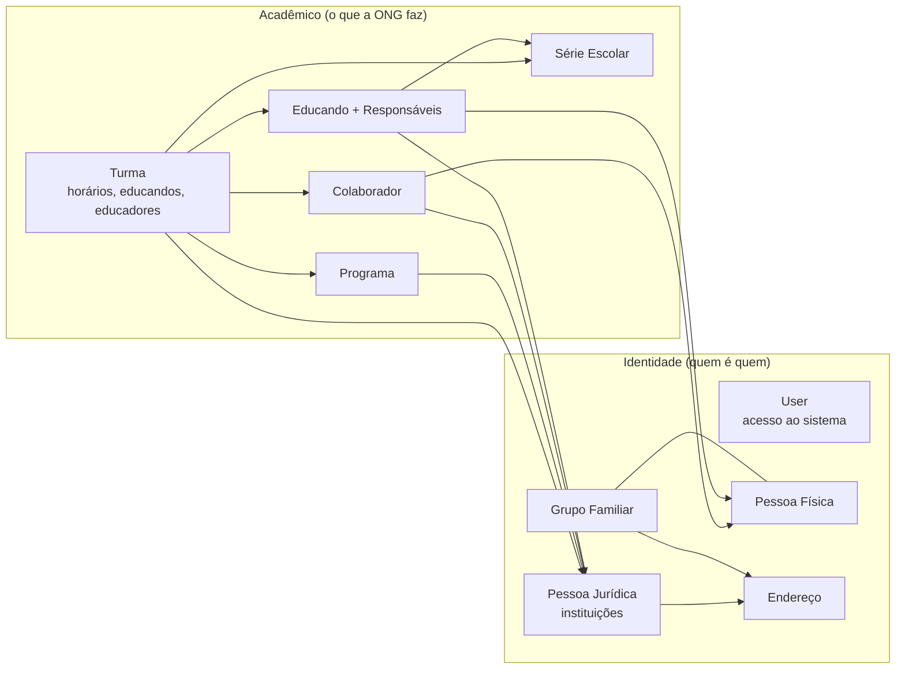

# Mapa de módulos (visão técnica)

> Visão **técnica** dos módulos. O contexto de **negócio** (processo da ONG, regras, o que falta) está em
> [`../negocio/README.md`](../negocio/README.md).

O **Projeto Resgate** é o sistema de gestão de uma ONG que oferece programas educacionais a crianças e
adolescentes (**educandos**). Este repositório é o **backend** (API REST). O front é um projeto separado
e consome esta API.

O sistema responde, no dia a dia da ONG, a perguntas como:

- Quem são os educandos, em que família vivem e quem são seus responsáveis?
- Em quais turmas cada educando está, em que dias e horários, e quem são os educadores?
- Quais programas existem, com qual instituição parceira (escola/empresa)?
- Quem desistiu, por quê, e quando voltou?

## Mapa de módulos

| Módulo               | Pacote                 | Em uma frase                                                                            |
|----------------------|------------------------|-----------------------------------------------------------------------------------------|
| **User**             | `identity/user`        | Quem entra no sistema (hoje, só administradores). Login, refresh, reset de senha.       |
| **Pessoa Física**    | `identity/naturalperson` | Qualquer pessoa: educando, responsável, educador. Uma só tabela de cadastro.          |
| **Pessoa Jurídica**  | `identity/legalperson` | Empresas e escolas. Serve de "instituição" para programas, turmas, educandos.          |
| **Grupo Familiar**   | `identity/familygroup` | Núcleo familiar (renda, despesas, moradores). Agrupa pessoas físicas.                   |
| **Endereço**         | `identity/address`     | Endereço reutilizado por pessoa jurídica e grupo familiar.                              |
| **Programa**         | `academic/program`     | Iniciativa educacional da ONG, com suas categorias de educador.                         |
| **Série Escolar**    | `academic/schoolgrade` | Catálogo de séries (1º ano, 2º ano…) com ordem e abreviação.                            |
| **Educando**         | `academic/learner`     | Papel "aluno" de uma pessoa física, com responsáveis e histórico de status.             |
| **Colaborador**      | `academic/collaborator`| Papel "educador/voluntário" de uma pessoa física, opcionalmente ligado a uma empresa.   |
| **Turma**            | `academic/classgroup`  | Programa + instituição + séries + horários + educandos + educadores, num período.       |

## Glossário

| Termo                    | Significado no sistema                                                                                          |
|--------------------------|-----------------------------------------------------------------------------------------------------------------|
| **Educando** (`Learner`) | Aluno atendido pela ONG. É uma *pessoa física* com dados acadêmicos extras. Uma pessoa só pode ser educando uma vez. |
| **Responsável**          | Pessoa física ligada a um educando. Tem **tipo** (`COMMUNICATION` ou `FINANCIAL`) e **parentesco** (`Kinship`). |
| **Colaborador**          | Pessoa física que atua como educador. Pode ser voluntário e vinculado a uma pessoa jurídica.                    |
| **Instituição**          | Uma *pessoa jurídica* usada como escola/parceiro de um programa, turma ou educando.                             |
| **Programa**             | Iniciativa (ex.: reforço escolar, arte). Define as **categorias de educador** válidas para suas turmas.         |
| **Categoria de educador**| `EducatorCategoryItem`: tipo de educador dentro de um programa (ex.: "Professor", "Auxiliar").                  |
| **Turma** (`ClassGroup`) | Oferta de um programa numa instituição, num período, para certas séries.                                        |
| **Grupo familiar**       | Família do educando. Tem um **ID amigável** `FAM-<n>`. O educando e seus responsáveis precisam pertencer a ele. |
| **Papel** (`NaturalPersonRole`) | Marca derivada: `LEARNER` ou `RESPONSIBLE`. Mantida automaticamente (ver [educandos](fluxo-educandos.md)).       |
| **Soft delete**          | Exclusão lógica: a linha ganha `deleted_at` e some das consultas. Nada é apagado fisicamente.                   |
| **Desistência** (`DROPOUT`) | Educando que sai da ONG. Fica registrada no histórico, com motivo obrigatório.                               |

## Princípios que atravessam o sistema

1. **Pessoa física é o cadastro único.** Educando, responsável e colaborador *apontam* para uma pessoa
   física; não duplicam nome, CPF etc. Os dados pessoais vivem em um só lugar.
2. **Tudo é soft delete.** Excluir um registro nunca perde histórico. Veja a
   [tabela de cascatas](regras-implementadas.md#exclusão-e-cascatas) para o que cada exclusão arrasta (e o que não arrasta).
3. **Regra de negócio mora na entidade.** `validate()` e métodos como `dropOut()` ficam no `domain`;
   a service só orquestra. Ver [`../architecture.md`](../architecture.md).
4. **Erro de regra = HTTP 400** com mensagem em português; não encontrado = 404. Ver
   [ADR 002](../adr/002-tratamento-de-erros.md).
5. **Texto para o usuário em português, código em inglês.** Ver [ADR 005](../adr/005-padroes-nomenclatura-idioma.md).

## Onde ir a seguir

| Quero entender…                                  | Documento                                              |
|--------------------------------------------------|--------------------------------------------------------|
| Como as tabelas se relacionam                    | [`modelo-de-dados.md`](modelo-de-dados.md)             |
| Login, refresh, logout, reset de senha           | [`autenticacao.md`](autenticacao.md)                   |
| Cadastro de família → educando → responsáveis    | [`fluxo-educandos.md`](fluxo-educandos.md)                         |
| Turmas, horários, título automático              | [`fluxo-turmas.md`](fluxo-turmas.md)                               |
| Todas as regras numa tabela só                   | [`regras-implementadas.md`](regras-implementadas.md)         |
| Todos os endpoints                               | [`endpoints.md`](endpoints.md)                         |
