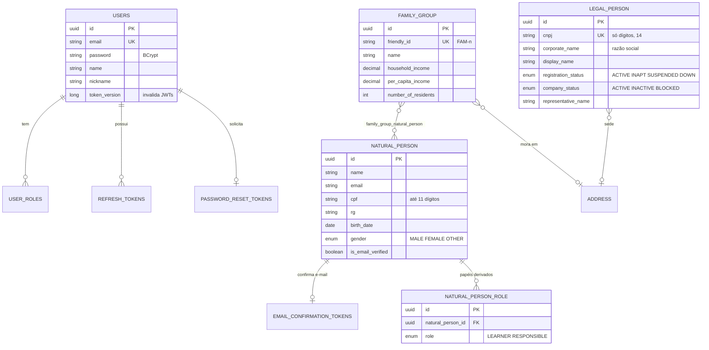
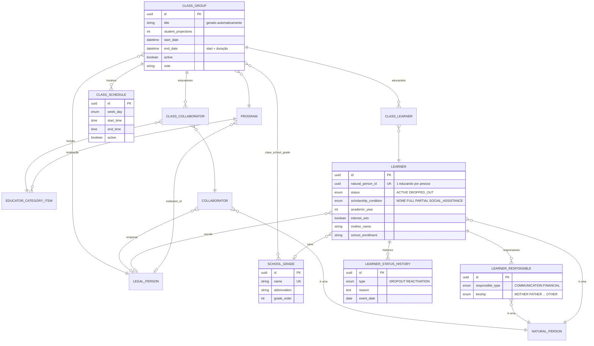
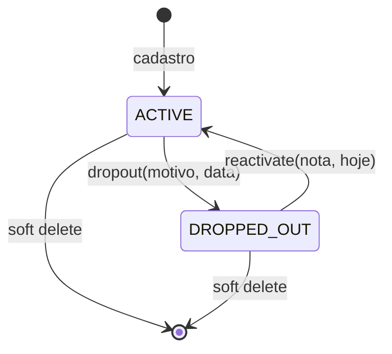

# Modelo de dados

Diagrama entidade-relacionamento conforme as migrations `V001`–`V017`. Para convenções de SQL e como criar
migrations, veja [`../banco-de-dados.md`](../banco-de-dados.md).

> **Convenção geral:** todas as tabelas de negócio têm `date_created`, `date_updated` e `deleted_at`
> (via `AuditableEntity`) e usam `UUID` como chave. Colunas de auditoria foram omitidas dos diagramas.

## Identidade

Pontos a notar:

- **`users` e `natural_person` são separados** (V005). `User` é quem *acessa o sistema*; `NaturalPerson`
  é uma pessoa *cadastrada* (educando, responsável, educador). Hoje não há vínculo entre eles.
- **Tokens guardam só o hash.** `refresh_tokens`, `password_reset_tokens` e `email_confirmation_tokens`
  armazenam `token_hash`; o valor em texto puro só existe no cookie/e-mail.
- **Endereço é compartilhado** entre `legal_person` e `family_group` (relação 1–1 com cascade).
  Não existe endereço para `natural_person`.
- `family_group.friendly_id` vem da sequence `family_group_friendly_id_seq` (V011) com prefixo `FAM-`.

## Acadêmico

Pontos a notar:

- **`ClassLearner`, `ClassCollaborator`, `ClassSchedule` e `ClassGroup` têm flag `active`** além do
  soft delete. `active=false` é "pausado/encerrado" (reversível e visível); `deleted_at` é "removido".
- **Referências por UUID, não por `@ManyToOne`**, em várias entidades (`Learner.naturalPersonId`,
  `ClassGroup.programId`…). A integridade vem das FKs do banco e das validações nas services — o JPA
  não carrega o objeto relacionado sozinho.
- **Unicidade:** um educando por pessoa física, um colaborador por pessoa física, um vínculo
  educando↔turma e colaborador↔turma. Os índices únicos são **parciais** (`WHERE deleted_at IS NULL`),
  então uma linha excluída libera a combinação para ser recriada.

## Estados do educando

Cada transição grava um `LearnerStatusHistory`. Detalhes em [`fluxo-educandos.md`](fluxo-educandos.md).

## Seed de desenvolvimento

`docker/database/init.sql` popula usuários admin, famílias, educandos, turmas etc. Roda **apenas**
no `docker compose` local (serviço `seeder`), depois das migrations. **Nunca roda em produção**, e
contém senhas de exemplo — não reaproveite essas credenciais.
